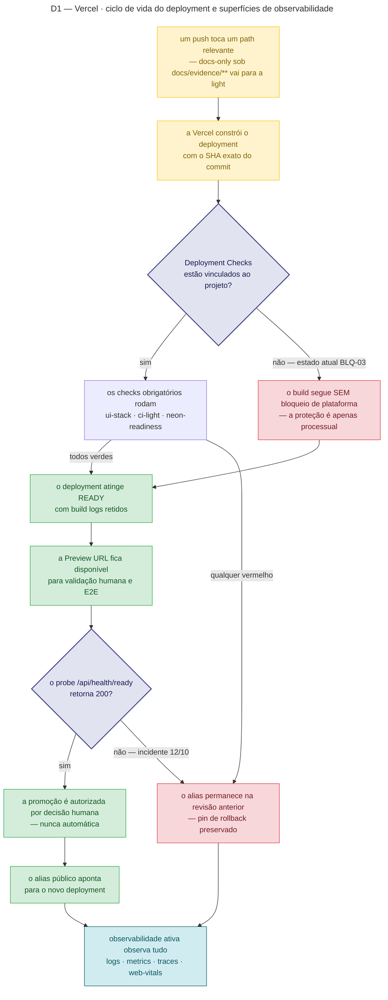
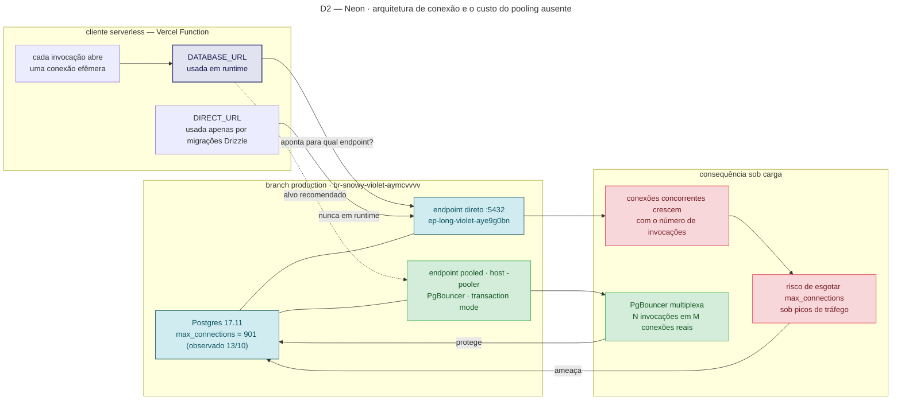
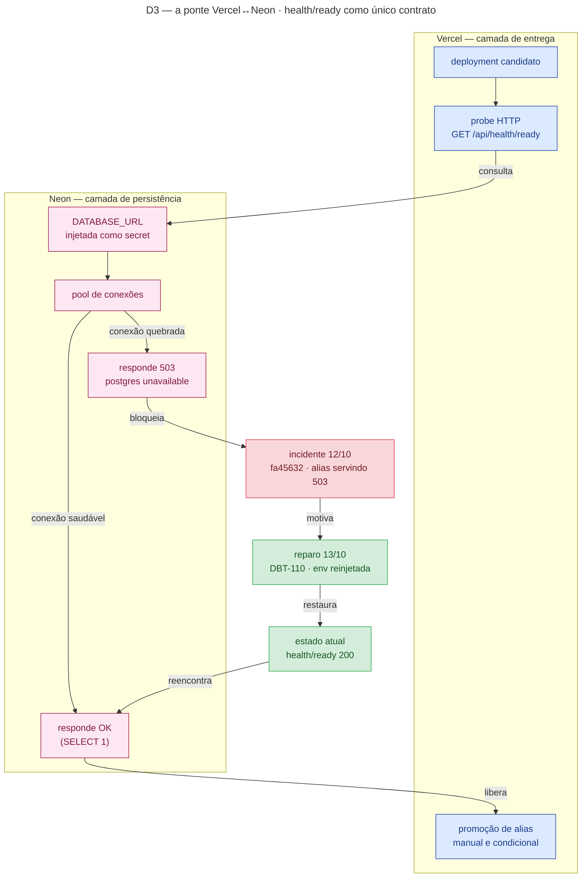
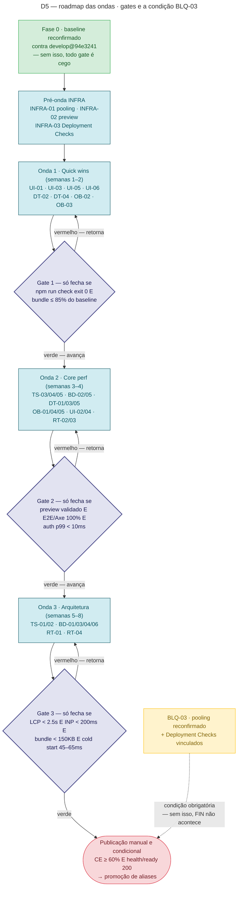
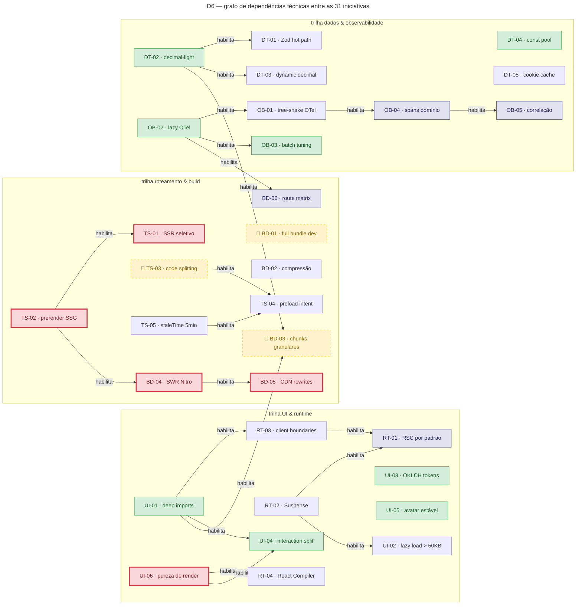
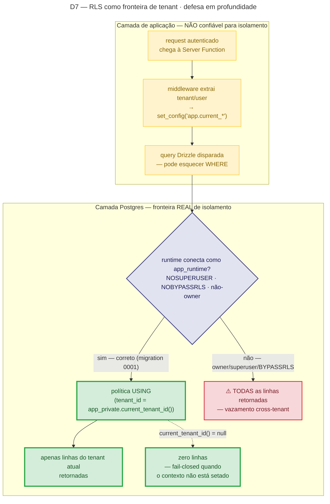
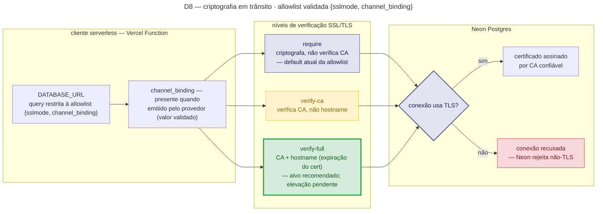
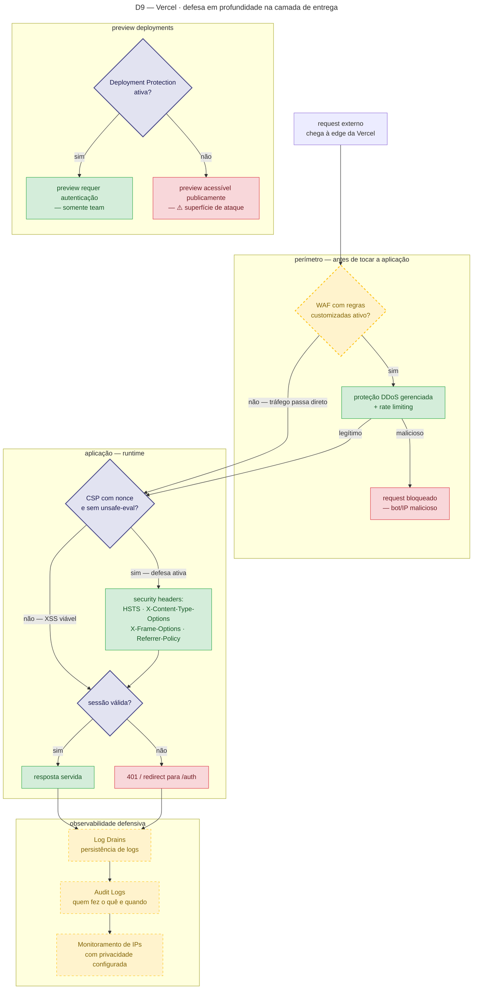

# Mapa Operacional — Diagramas Canônicos (D1–D10)

**Propósito.** Dez diagramas normativos em três camadas — **Plataforma (D1–D3)**, **Processo (D4–D6)** e **Segurança (D7–D10)** — que operacionalizam, em forma executável, os contratos do `AGENTS.md` e dos ADRs. Cada losango é um gate: **um push, query ou promoção que viole um losango é bug do agente**, não interpretação.

**Precedência.** Em caso de divergência, **o `AGENTS.md` e os ADRs vencem**. Este mapa não cria política nova: ele deriva, conecta e registra o estado (verificado × pendente) — e é atualizado no **mesmo commit** de qualquer mudança no `AGENTS.md`, num ADR ou no código que ele retrate.

**Estado vivo.** O estado corrente (o que está verificado e o que é pendência nomeada) fica na **§6 — Estado e pendências**; o roadmap das otimizações referenciado por D5/D6 vive em `docs/evidence/otimizacoes-planejamento/PLANEJAMENTO.md`.

**Correções de reconciliação aplicadas a este mapa (2026-10-16).** Primitivas reais de RLS (`app_private.current_user_id()` / `app_private.current_tenant_id()` sobre `current_setting('app.current_*')`; role `app_runtime` NOSUPERUSER/NOBYPASSRLS — migration `0001_p0_runtime_role_and_rls.sql`); `FORCE ROW LEVEL SECURITY` **não existe hoje** no schema (0 ocorrências em `drizzle/*.sql`) e entra como defesa adicional pendente, não como gate vigente; endpoint pooled do Neon distingue-se pelo **host `-pooler`** (a URI canônica fixa `:5432`), não por porta `:6432`; o contrato TLS é a allowlist validada **`{sslmode, channel_binding}` com default `sslmode=require`** (a elevação a `verify-full` é decisão pendente, nunca edição de prosa).

## Índice

- [1. Vínculos com o AGENTS.md](#1-vínculos-com-o-agentsmd)
- [2. Plataforma — D1–D3](#2-plataforma--d1d3)
  - [D1 — Vercel · ciclo de vida do deployment](#d1--vercel-·-ciclo-de-vida-do-deployment)
  - [D2 — Neon · arquitetura de conexão](#d2--neon-·-arquitetura-de-conexão)
  - [D3 — A ponte entre Vercel e Neon · health/ready](#d3--a-ponte-entre-vercel-e-neon-·-healthready)
- [3. Processo — D4–D6](#3-processo--d4d6)
  - [D4 — Ciclo CI/CD](#d4--ciclo-cicd)
  - [D5 — Roadmap das ondas](#d5--roadmap-das-ondas)
  - [D6 — Grafo de dependências](#d6--grafo-de-dependências)
- [4. Segurança — D7–D10](#4-segurança--d7d10)
  - [D7 — RLS como fronteira de tenant](#d7--rls-como-fronteira-de-tenant)
  - [D8 — Criptografia em trânsito](#d8--criptografia-em-trânsito)
  - [D9 — Defesa em profundidade na Vercel](#d9--defesa-em-profundidade-na-vercel)
  - [D10 — Cadeia criptográfica completa](#d10--cadeia-criptográfica-completa)
- [5. Gates de segurança (referência cruzada)](#5-gates-de-segurança-referência-cruzada)
- [6. Estado e pendências](#6-estado-e-pendências)
- [7. Manutenção e precedência](#7-manutenção-e-precedência)

---

## 1. Vínculos com o AGENTS.md

Cada diagrama deriva de seções específicas do `AGENTS.md` (e dos ADRs citados por elas). Este é o contrato de rastreabilidade do mapa:

| Diagrama | Camada     | Seções do `AGENTS.md` que operacionaliza                                                                                                                               |
| -------- | ---------- | ---------------------------------------------------------------------------------------------------------------------------------------------------------------------- |
| D1       | Plataforma | **Three CI pipelines** (seleção por path, light × heavy); **Deployment contract** (publicação manual e condicional, C26/ADR-042); Baseline de segurança (CSP)          |
| D2       | Plataforma | **Three permanent Neon branches only**; **Local database** (env guard, denylist de produção, `ALLOW_REMOTE_DB`); allowlist de URI no provisionamento Neon              |
| D3       | Plataforma | **Deployment contract** (publish o SHA exato do main só após CE real e runtime checks; "health 200" como pré-condição de promoção de alias)                            |
| D4       | Processo   | **Branching** (PR-only para `main`, règles 24333849/24347682); **Local quality gate** (cadeia `check`, tiers do `verify`); Sonar/CE (ADR-042/ADR-044)                  |
| D5       | Processo   | **Deployment contract** + roadmap em `docs/evidence/otimizacoes-planejamento/PLANEJAMENTO.md` (§4 e §8); condição BLQ-03 (ver §6)                                      |
| D6       | Processo   | `PLANEJAMENTO.md` §3 (fichas) e §4.3 (dependências); fichas bloqueadas 🔶 (TS-03/BD-01/BD-03)                                                                          |
| D7       | Segurança  | **Security baseline** (INV-008); **Local database** (denylist absoluta de produção); migration `0001_p0_runtime_role_and_rls.sql`; `scripts/rls-probe.mjs` (`db:test`) |
| D8       | Segurança  | Allowlist de URI no provisionamento Neon (`{sslmode, channel_binding}`, default `require`); **Local database** (env guard)                                             |
| D9       | Segurança  | **Security baseline** (CSP estrita em `src/start.ts`); **Deployment contract** (previews; Deployment Protection evidenciada)                                           |
| D10      | Segurança  | **Security baseline** (DeepSeek/Web-only, redaction); ADR-033 (redaction antes de persistir); ADR-043 (CSP nonce); fichas OB-04/OB-05                                  |

---

## 2. Plataforma — D1–D3

### D1 — Vercel · ciclo de vida do deployment

**Legenda — o que cada nó exige e onde vive no `AGENTS.md`:**

- **paths-ignore (PUSH):** apenas `docs/evidence/**` é tratado como docs-only e roda a light; **qualquer outro path** dispara o heavy `verify` — título _"Three CI pipelines, selected by paths"_. Um push misto (código + docs) pertence à heavy.
- **DC — Deployment Checks (losango):** hoje **não vinculados** (BLQ-03, ver §6). Enquanto o estado for "não", a proteção é **processual** (SKIP), nunca presumida como de plataforma. O caminho normativo é vincular os checks antes da promoção (INFRA-03).
- **HEALTH (losango):** `/api/health/ready` = 200 é **pré-condição de promoção**. O incidente de 12/10 (`fa45632` servindo 503 `postgres unavailable`) e o reparo de 13–14/10 (`dpl_9v4ni1M`, `dpl_3zbrc9h`) são o precedente: health ≠ 200 ⇒ promoção abortada e aliases mantidos.
- **PROMOTE:** publicação **manual e condicional** (C26/ADR-042) — nunca automática; o SHA promovido é o exato do `main` com CE real aprovado.
- **OBS:** observabilidade ativa (logs/metrics/traces/web-vitals) é contrato do tier e2e e da camada OTel; ela observa **os dois desfechos** (alias novo e rollback pinado).

### D2 — Neon · arquitetura de conexão

**Legenda — vínculos e gates:**

- **Três branches permanentes, nunca mais:** `production` (`br-snowy-violet-aymcvvvv`), `develop` (`br-small-hill-aymcu14y`) e a fonte de fixture vazia `ci-fixture-base` — seção _"Three permanent Neon branches only"_. Cópias de CI são efêmeras, identificadas por run, TTL 24h e descarte com GET 404.
- **`DATABASE_URL` de runtime vs `DIRECT_URL` de migração:** a conexão direta é a exceção (migrações); o runtime nunca deve carregar credencial owner — **Local database / env guard**: o endpoint de produção é **negado incondicionalmente** nos pre-hooks, sem override que o reabra.
- **Pooling (resíduo BLQ-01):** a observação herdada (`pooler_enabled=false`, conexão direta) **não foi reconfirmada** após o reparo de env de 13/10; verificação live é obrigatória e a promoção a `-pooler` é **decisão pendente INFRA-01** (incluindo compatibilidade do driver com transaction pooling — prepared statements). Não codifique a troca por suposição.
- **URI canônica:** a allowlist validada é `{sslmode, channel_binding}` com **porta 5432 explícita** — nenhum parâmetro movedor de destino é aceito (seção _"Provisionamento da fixture Neon de PR"_).

### D3 — A ponte entre Vercel e Neon · health/ready

**Legenda — vínculos e gates:**

- **Contrato único:** nenhum componente da Vercel fala com o Neon além do probe de prontidão — _Deployment contract_: publicar o SHA exato do `main` **somente** depois do CE real (≥ 60%, ADR-042) e dos runtime checks aplicáveis.
- **Fail-closed:** `UNHEALTHY` ⇒ o alias **não** promove; o pin de rollback permanece. O histórico do incidente/reparo (DBT-110/DBT-115, FECHADAS) é evidência versionada, não presunção.
- **Estado atual:** produção saudável no deployment vigente do `main`; qualquer nova promoção repete a cadeia inteira — o mapa não carrega "verde" de uma rodada para a seguinte.

---

## 3. Processo — D4–D6

### D4 — Ciclo CI/CD

```mermaid
---
title: "D4 — ciclo CI/CD · do gate local ao alias público"
---
flowchart LR
    %% A pergunta única do pipeline: "este SHA merece tocar o alias público?"
    %% Nenhuma etapa abaixo é decorativa — cada uma é uma recusa potencial.

    subgraph LOCAL["1 · máquina local"]
        direction TB
        DEV["agente em develop"]
        GATE["npm run check<br/>cadeia completa · 2.274 testes<br/>(baseline herdado — reconfirmar em develop@94e3241)"]
        GREEN{"verde?"}
    end

    subgraph GH["2 · GitHub Actions"]
        direction TB
        PUSH["push em develop"]
        UI["ui-stack.yml<br/>verify-release"]
        LIGHT["ci-light.yml<br/>prettier · guardas"]
        NEON["neon-readiness.yml<br/>readiness de conexões"]
        MATRIZ["matriz completa<br/>heavy runner"]
    end

    subgraph CE["3 · gate de engenharia"]
        direction TB
        READOUT["gate-readout<br/>new_coverage ≥ 60%"]
        DECISAO{"decisão humana<br/>sobre promoção"}
    end

    subgraph VRC["4 · Vercel"]
        direction TB
        BUILD["build do SHA exato"]
        CHECK{"Deployment Checks<br/>vinculados?"}
        PROMO["promoção manual<br/>de alias"]
    end

    ALIAS["alias público"]

    DEV --> GATE
    GATE --> GREEN
    GREEN -->|"sim"| PUSH
    GREEN -->|"não — não push"| DEV
    PUSH --> UI
    PUSH --> LIGHT
    PUSH --> NEON
    UI --> MATRIZ
    LIGHT --> MATRIZ
    NEON --> MATRIZ
    MATRIZ -->|"todos verdes"| READOUT
    MATRIZ -->|"qualquer vermelho"| DEV
    READOUT --> DECISAO
    DECISAO -->|"autoriza"| BUILD
    DECISAO -->|"recusa"| DEV
    BUILD --> CHECK
    CHECK -->|"sim — bloqueia até verde"| PROMO
    CHECK -->|"não — promoção é manual pura"| PROMO
    PROMO --> ALIAS

    classDef gate fill:#e2e3f1,stroke:#4a4a8a,color:#1a1a4e,stroke-width:2px
    classDef local fill:#fff3cd,stroke:#ffc107,color:#856404
    classDef github fill:#dbeafe,stroke:#1e40af,color:#1e3a8a
    classDef ce fill:#fce7f3,stroke:#9d174d,color:#831843
    classDef vercel fill:#d1ecf1,stroke:#0c5460,color:#0c5460

    class GREEN,DECISAO,CHECK gate
    class DEV,GATE local
    class PUSH,UI,LIGHT,NEON,MATRIZ github
    class READOUT ce
    class BUILD,PROMO,ALIAS vercel
```

**Legenda — vínculos e gates:**

- **1 · Local:** `npm run check` é o gate de definição de pronto (_Local quality gate_); o número de testes é o baseline herdado e **precisa ser reconfirmado contra `develop@94e3241`** (§0 do planejamento). Push sem o gate local desperdiça um ciclo de CI.
- **2 · GitHub Actions:** a seleção por path é contrato (_"Three CI pipelines, selected by paths"_): docs-only sob `docs/evidence/**` → light; qualquer outro path (código, `AGENTS.md`, `docs/` fora de evidence) → heavy; PR sempre roda a matriz completa. Os tiers do `verify` são fail-closed (base desconhecida ⇒ tudo roda).
- **3 · CE:** `gate-readout` observa a CE real do provedor e aplica o piso ADR-042 (≥ 60%) **sem alterar o veredito do provedor**; `NO-VERDICT`/`ERROR` bloqueiam. A decisão de promoção é **humana** — o gate técnico habilita, nunca autoriza.
- **4 · Vercel:** `CHECK` reflete o estado do D1 — hoje "não" (BLQ-03 aberto): a promoção manual é a única trava. Quando os Deployment Checks forem vinculados, o ramo "sim" passa a bloquear promoção até os checks verdes.
- **`develop` é o único canal:** implementação (inclusive correções de segurança e dependências) integra em `develop`; `main` recebe só o PR final (_Branching_).

### D5 — Roadmap das ondas

**Legenda — vínculos e gates:**

- **Fonte:** `PLANEJAMENTO.md` §4.2 (gates com critérios completos e checklists) e §8 (decisões em formato ADR). Este diagrama é o resumo normativo; o detalhe mensurável vive lá.
- **BLQ-03 é condição, não onda:** os critérios de performance do Gate 3 são **necessários, mas não suficientes** — a publicação exige pooling reconfirmado/ativo **e** Deployment Checks vinculados. Performance verde com BLQ-03 aberto **não libera** promoção.
- **Fase 0 é pré-condicional:** o baseline de 2.274 testes / `sha256=30ca04baaa66` foi capturado antes do PR #64 — sem a reconfirmação contra `develop@94e3241`, todos os gates comparam contra um número não verificado.
- **Porta única permanece:** `FIN` repete o contrato do D3/D1 — CE ≥ 60%, `health/ready` 200, promoção manual.

### D6 — Grafo de dependências

**Legenda — vínculos e gates:**

- **Fonte:** `PLANEJAMENTO.md` §3.0 (índice com Status por ficha) e §4.3 (caminho crítico declarado). As 31 fichas têm critérios de aceite e evidências exigidas próprios.
- **🔶 Bloqueadas (TS-03, BD-01, BD-03):** têm divergência de reconciliação com o código/config vigente (`autoCodeSplitting` fora do schema pinado; feature do Vite 8 a validar; `codeSplitting.groups` vigente) — **validar antes de codificar**, nunca presumir.
- **Caminho crítico:** `UI-06 → RT-04` e `TS-02 → TS-01 / BD-04 → BD-05` — atrasos nesses nós propagam-se para a Onda 3 e para o Gate 3.

---

## 4. Segurança — D7–D10

### D7 — RLS como fronteira de tenant

**Legenda — vínculos e gates:**

- **Primitivas reais:** `app_private.current_user_id()` e `app_private.current_tenant_id()` leem `current_setting('app.current_user_id' / 'app.current_tenant_id', true)` (retorno `null` quando ausente ⇒ fail-closed); funções `REVOKE` de `PUBLIC` e `GRANT EXECUTE` só para `app_runtime` (migration `0001_p0_runtime_role_and_rls.sql`).
- **Role de runtime:** `app_runtime` foi criada `LOGIN NOSUPERUSER NOCREATEDB NOCREATEROLE NOINHERIT NOREPLICATION NOBYPASSRLS` — o isolamento repousa em **nunca** usar owner/superuser em runtime (_Local database_: a denylist de produção é absoluta; admin URLs só em migrações/testes).
- **Prova:** `scripts/rls-probe.mjs` (dentro do `db:test`) conecta como `app_runtime`, seta `app.current_user_id`/`app.current_tenant_id`/`app.current_roles` e tenta leitura **e escrita** cross-tenant; qualquer vazamento é violação com parada de linha. O gate visual INV-008 (tenant A nunca vê B) cobre o mesmo invariante pela UX.
- **`FORCE ROW LEVEL SECURITY`:** **ausente hoje** (0 ocorrências em `drizzle/*.sql`) — ele só importa para conexão owner; adotá-lo é decisão de defesa adicional registrada em §6, nunca presumida como ativa.

### D8 — Criptografia em trânsito

**Legenda — vínculos e gates:**

- **Contrato vigente (código):** `scripts/ci/neon-resource.ts` fixa a URI canônica com **porta 5432 explícita**, permite apenas `{sslmode, channel_binding}` (valores validados: `sslmode ∈ {require, verify-ca, verify-full}`) e **default `require`** quando ausente — nenhum parâmetro movedor de destino é aceito (_"URIs de todas as cópias Neon"_ no enquadramento do provisionamento).
- **Nível por nível:** `require` criptografa mas não valida a CA; `verify-ca` valida a CA mas não o hostname; `verify-full` valida CA + hostname — é o **alvo recomendado**, ainda **pendente** de promoção a padrão (INFRA-01/§6). MITM com certificado válido só é barrado no nível `verify-full`.
- **Regra de manutenção:** endurecer ou afrouxar esse contrato **exige mudança de código + teste** — prosa (inclusive este mapa) não altera allowlist.

### D9 — Defesa em profundidade na Vercel

**Legenda — vínculos e gates:**

- **CSP (losango):** a política de `src/start.ts` é estrita (`script-src 'self'`, nonce — ADR-043) e **nunca** ganha `'unsafe-inline'`/hosts novos sem verificação no dist publicado e evidência no PR (_Security baseline_).
- **Deployment Protection (losango):** **evidenciada ativa** — probe 2026-09-12 mediu `302 → vercel.com/sso-api` em deployment URL de preview (`docs/evidence/vercel-docmap-2026-09-12.md`) e os aliases protegidos responderam `401` sem autenticação (fechamento DBT-115); o **escopo exato por ambiente** (preview vs deployment URL vs domínio de produção) segue como reconfirmação de painel — não presumir.
- **WAF / Log Drains / Audit Logs (tracejados `a verificar`):** sem evidência versionada de configuração no projeto. Norma: verificar/configurar **antes da promoção** (INFRA-03/Gate 3); status vive na §6.
- **`PREVIEW_PUB` é risco nomeado:** preview aberto é superfície de ataque — o estado alvo é `PREVIEW_PRIV` com Deployment Protection ativa e escopo declarado.

### D10 — Cadeia criptográfica completa

```mermaid
---
title: "D10 — cadeia criptográfica completa · do token ao span"
---
flowchart LR
    %% Cada nó é um artefato criptográfico. Cada aresta é um salto que DEVE ser verificado.
    %% Nenhum segredo em evidência; nenhum PII em span.

    subgraph ORIGEM["origem — autenticação"]
        direction TB
        OAUTH["OAuth provider<br/>emite ID token"]
        JWT["JWT assinado<br/>contém user_id / tenant_id"]
        SESSION["sessão better-auth<br/>cookie assinado com BETTER_AUTH_SECRET"]
    end

    subgraph TRANSITO["trânsito — cada salto protegido"]
        direction TB
        TLS_APP["TLS 1.2/1.3<br/>browser ↔ edge"]
        CSP["CSP nonce<br/>script inline autorizado"]
        TLS_DB["TLS Neon<br/>allowlist {sslmode, channel_binding}"]
    end

    subgraph DESTINO["destino — persistência e observabilidade"]
        direction TB
        RLS["RLS policy<br/>app_private.current_user_id() / current_tenant_id()"]
        AES["AES-256<br/>dados em repouso (Neon)"]
        TRACE["traceparent W3C<br/>correlação front↔back"]
        SPAN["span OTel<br/>sem PII nos atributos"]
    end

    OAUTH --> JWT
    JWT --> SESSION
    SESSION --> TLS_APP
    TLS_APP --> CSP
    CSP --> TLS_DB
    TLS_DB --> RLS
    RLS --> AES
    AES --> TRACE
    TRACE --> SPAN

    classDef criptoOrigem fill:#fce7f3,stroke:#9d174d,color:#831843
    classDef criptoTransito fill:#dbeafe,stroke:#1e40af,color:#1e3a8a
    classDef criptoDestino fill:#d4edda,stroke:#28a745,color:#155724,stroke-width:3px

    class OAUTH,JWT,SESSION criptoOrigem
    class TLS_APP,CSP,TLS_DB criptoTransito
    class RLS,AES,TRACE,SPAN criptoDestino
```

**Legenda — vínculos e gates:**

- **Origem:** sessão `better-auth` com cookie cache assinado (ADR-020/ADR-025, ficha DT-05); `BETTER_AUTH_SECRET` nunca em contexto de agente nem em evidência (_Security baseline_).
- **Trânsito:** cada salto com seu contrato — CSP nonce (ADR-043) no HTML/SSR; TLS do Neon na allowlist validada (D8). Nenhum salto "implícito" é aceito.
- **Destino:** a RLS usa as **primitivas reais** (`app_private.current_*`, migration 0001 — não existe `auth.user_id()` neste schema); repouso criptografado pelo Neon; correlação `traceparent` W3C é a ficha **OB-05** (a implementar — ver §6); atributos de span **sem PII** por contrato (ADR-033/redaction; a mesma regra da captura visual: redação antes da persistência, sempre).
- **MTTR:** a cadeia só fecha quando um Web Vital no navegador e o span correspondente no servidor compartilham o mesmo `traceId` auditável (critério de aceite OB-05).

---

## 5. Gates de segurança (referência cruzada)

| Diagrama | Camada                          | Gate que adiciona                                                                              | Ficha afetada         | Estado (2026-10-16)                                                                                                                 |
| -------- | ------------------------------- | ---------------------------------------------------------------------------------------------- | --------------------- | ----------------------------------------------------------------------------------------------------------------------------------- |
| D7       | RLS / tenant isolation          | runtime `app_runtime` (NOSUPERUSER · NOBYPASSRLS · não-owner) + fail-closed a contexto ausente | DT-01, DT-05, OB-04   | **Implementado** (migration `0001`; `rls-probe` no `db:test`; INV-008 visual). `FORCE RLS` ausente — defesa adicional pendente (§6) |
| D8       | TLS / criptografia em trânsito  | allowlist `{sslmode, channel_binding}` com default `require`; elevação a `verify-full`         | INFRA-01              | Allowlist **implementada** (código + teste); elevação a `verify-full` **pendente de decisão**                                       |
| D9       | Vercel / defesa em profundidade | CSP + Deployment Protection + WAF + Log Drains verificados **antes da promoção**               | INFRA-03, Gate 3      | CSP estrita **ativa**; Deployment Protection **evidenciada** (302→sso / 401); WAF, Log Drains e Audit Logs **a verificar**          |
| D10      | Cadeia criptográfica completa   | JWT → TLS → RLS → AES → `traceparent` **sem PII**                                              | OB-04, DT-05, ADR-043 | Até RLS/AES/sessão: ativos; `traceparent` front↔back = **OB-05, a implementar**                                                     |

> [!IMPORTANT]
> Um gate em estado **pendente** não deixa de ser normativo: o agente não pode **produzir o estado que ele proíbe** (ex.: promover alias sem `health 200`, usar owner em runtime, editar prosa de TLS/allowlist, exercer cross-tenant em teste). O que muda é apenas onde a pendência fecha — na §6.

## 6. Estado e pendências

Estado corrente do que este mapa declara normativo — cada pendência tem caminho de fechamento nomeado. Nada aqui é presumido:

| #   | Item                                              | Estado                                          | Evidência / onde fecha                                                             |
| --- | ------------------------------------------------- | ----------------------------------------------- | ---------------------------------------------------------------------------------- |
| 1   | BLQ-03 — Deployment Checks vinculados (D1/D4)     | **Aberto**                                      | `PLANEJAMENTO.md` §2.6/§4.2/§8; fecha com INFRA-03 + Decisão 2                     |
| 2   | Pooling do Neon reconfirmado/ativo (D2)           | **A reconfirmar** (observação pré-13/10)        | `captures/neon-endpoints-pooling.json`; fecha com INFRA-01 + Decisão 1             |
| 3   | `sslmode=verify-full` como padrão (D8)            | **Decisão pendente** (hoje default `require`)   | Código `scripts/ci/neon-resource.ts`; fecha com INFRA-01 + mudança de código/teste |
| 4   | WAF / Log Drains / Audit Logs configurados (D9)   | **A verificar** (sem evidência versionada)      | Painel/API Vercel; fecha com INFRA-03/Gate 3                                       |
| 5   | Escopo exato da Deployment Protection (D9)        | **Evidência parcial** (302→sso; 401 em aliases) | `docs/evidence/vercel-docmap-2026-09-12.md`; fecha com reconfirmação de painel     |
| 6   | `FORCE ROW LEVEL SECURITY` (defesa adicional, D7) | **Ausente hoje** (0 ocorrências)                | `drizzle/*.sql`; fecha com migration + teste, se decidido                          |
| 7   | Baseline de qualidade reconfirmado (D4/D5)        | **A reconfirmar** contra `develop@94e3241`      | Checklist acionável em `PLANEJAMENTO.md` §0                                        |
| 8   | Correlação `traceparent` front↔back (D10)         | **A implementar**                               | Ficha OB-05 (`PLANEJAMENTO.md` §3.7)                                               |

Pendências de **verificação live** herdadas (V-01..V-04) permanecem como no planejamento — este mapa não as duplica, apenas as referencia por caminho.

## 7. Manutenção e precedência

- **Precedência:** `AGENTS.md` e os ADRs vencem este mapa. Divergência entre os dois é **bug** — corrige-se o mapa (ou, com ADR, o contrato), nunca se "interpreta" a divergência.
- **Mesmo commit:** qualquer mudança no `AGENTS.md`, num ADR ou em código que mude um gate daqui **atualiza este mapa no mesmo commit** (e vice-versa quando o mapa for a origem da mudança). A regra do `AGENTS.md` (_"Note for agents"_) vale integralmente aqui.
- **Prosa não altera contrato:** allowlists, níveis de TLS, expressões de RLS e nomes de role só mudam com **código + teste** correspondentes; este documento nunca é fonte primária desses valores — ele aponta para onde eles vivem.
- **Formatação:** o arquivo é markdown comum sob `format:check` (`prettier`); diagramas usam `flowchart` com frontmatter, IDs significativos e `classDef` — sem `linkStyle` (índices frágeis).
- **Taxonomia de estado:** `Implementado` · `Evidenciado` · `A verificar` · `A reconfirmar` · `Decisão pendente` · `A implementar` — os mesmos verbos da §6; qualquer estado novo usado aqui precisa manter a distinção entre **verificado** e **pendente**.

---

_Mapa operacional criado em 2026-10-16 a partir dos diagramas canônicos D1–D10 fornecidos, reconciliados contra o repositório (migrations, `scripts/ci/neon-resource.ts`, `scripts/rls-probe.mjs`, evidências versionadas) e conectados por seção ao `AGENTS.md` e ao `docs/evidence/otimizacoes-planejamento/PLANEJAMENTO.md`. Nada foi commitado, pushado ou publicado._
