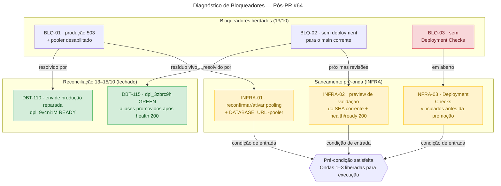
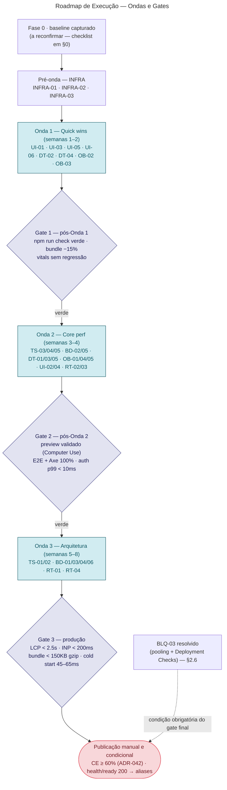
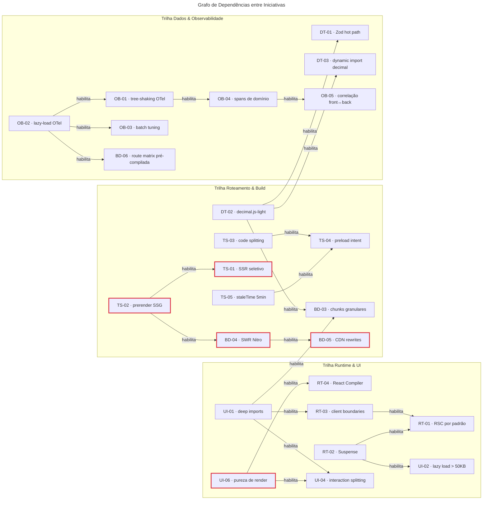

# Planejamento Extenso de Otimizações — Design System & Eficiência Computacional

**Projeto:** Preço Que Dá Lucro
**Data de referência:** 2026-10-15 (relatório herdado) · reconciliado em **2026-10-16**
**Base Git reconciliada:** `main` = `ef7568e216ac9871e04af8b13b53f61664503367` (merge do PR #64) · `develop` = `94e32411d29f54270db9759170f27536c3fbf43e`
**Estado de sincronização:** `git merge-base --is-ancestor origin/main origin/develop` = OK (back-merge íntegro) · worktree limpo
**Baseline reportado (a reconfirmar na captura da Fase 0):** 2.274 testes PASS no Vitest · hash de bundle `sha256=30ca04baaa66`
**Status:** aguardando gate humano — Decisões 1–4 em §8. Nenhuma alteração de código, env, commit, push ou deploy foi executada.

> [!NOTE]
> **Como ler este documento.** §0 reconcilia o relatório herdado com o estado real do repositório. §1–§2 são o diagnóstico (Fase 0). §3 são as 31 fichas técnicas (Fase 1) agrupadas por camada, cada uma com esforço, risco, dependências, critérios de aceite e evidências exigidas. §4 é o roadmap em ondas com fluxograma e grafo de dependências (Fase 2). §5 são os critérios de aceite, o plano de evidências e a observabilidade dos gates (Fase 3). §6 riscos, §7 invariantes do repositório, §8 decisões humanas pendentes em formato ADR, Apêndices A–B com o script de captura e a árvore de evidências esperada.

## Sumário

- [0. Reconciliação do Estado Herdado (2026-10-16)](#0-reconciliação-do-estado-herdado-2026-10-16)
  - [Estado atual (resumo)](#estado-atual-resumo)
  - [Detalhamento da reconciliação](#detalhamento-da-reconciliação)
  - [Pendências de verificação live](#pendências-de-verificação-live)
- [1. Sumário Executivo](#1-sumário-executivo)
  - [1.1 Métricas-Alvo Globais](#11-métricas-alvo-globais)
- [2. Fase 0 — Diagnóstico e Saneamento](#2-fase-0--diagnóstico-e-saneamento)
  - [2.1 Git (reconciliado em 2026-10-16)](#21-git-reconciliado-em-2026-10-16)
  - [2.2 Vercel — estado reconciliado](#22-vercel--estado-reconciliado)
  - [2.3 Deployment Checks na Vercel](#23-deployment-checks-na-vercel)
  - [2.4 Neon — branch de produção, pooling e migrações](#24-neon--branch-de-produção-pooling-e-migrações)
  - [2.5 Qualidade e baseline local (herdado — a reconfirmar)](#25-qualidade-e-baseline-local-herdado--a-reconfirmar)
  - [2.6 Bloqueadores herdados — status reconciliado](#26-bloqueadores-herdados--status-reconciliado)
  - [2.7 Plano de saneamento infraestrutural (pré-requisito operacional)](#27-plano-de-saneamento-infraestrutural-pré-requisito-operacional)
- [3. Fase 1 — Fichas Técnicas (31 melhorias)](#3-fase-1--fichas-técnicas-31-melhorias)
  - [3.0 Índice geral](#30-índice-geral)
  - [3.1 Template de ficha](#31-template-de-ficha)
  - [3.2 Camada Runtime — React 19 + RSC](#32-camada-runtime--react-19--rsc)
  - [3.3 Camada TanStack Start + Router + Query](#33-camada-tanstack-start--router--query)
  - [3.4 Camada Build & Server — Vite 8 + Nitro 3](#34-camada-build--server--vite-8--nitro-3)
  - [3.5 Camada Design System — shadcn/ui + Base UI (`@base-ui/react` 1.6.0)](#35-camada-design-system--shadcnui--base-ui-base-uireact-160)
  - [3.6 Camada Dados, Validação, Matemática Financeira e Auth](#36-camada-dados-validação-matemática-financeira-e-auth)
  - [3.7 Camada Observabilidade — OpenTelemetry (`src/instrumentation`)](#37-camada-observabilidade--opentelemetry-srcinstrumentation)
- [4. Fase 2 — Roadmap de Execução](#4-fase-2--roadmap-de-execução)
  - [4.1 Matriz de priorização (impacto × esforço)](#41-matriz-de-priorização-impacto-×-esforço)
  - [4.2 Cronograma por ondas de execução](#42-cronograma-por-ondas-de-execução)
  - [4.3 Grafo de dependências técnicas](#43-grafo-de-dependências-técnicas)
- [5. Fase 3 — Critérios de Aceite e Plano de Evidências](#5-fase-3--critérios-de-aceite-e-plano-de-evidências)
  - [5.1 Critérios consolidados por camada](#51-critérios-consolidados-por-camada)
  - [5.2 Matriz de evidências obrigatórias](#52-matriz-de-evidências-obrigatórias)
  - [5.3 Observabilidade ativa dos gates](#53-observabilidade-ativa-dos-gates)
- [6. Riscos e Mitigações](#6-riscos-e-mitigações)
- [7. Invariantes do Repositório Aplicáveis a Este Plano](#7-invariantes-do-repositório-aplicáveis-a-este-plano)
- [8. Decisões Humanas Pendentes (Gate de Aprovação)](#8-decisões-humanas-pendentes-gate-de-aprovação)
  - [Decisão 1 — Pooling do Neon + `DATABASE_URL` `-pooler`](#decisão-1--reconfirmar-e-ativar-pooling-do-neon-com-database_url-no-host--pooler)
  - [Decisão 2 — Deployment Checks + preview por revisão](#decisão-2--deployment-checks-obrigatórios--preview-de-validação-por-revisão)
  - [Decisão 3 — Onda 1 direto em `develop`](#decisão-3--onda-1-executada-diretamente-em-develop-sem-branch-de-trabalho)
  - [Decisão 4 — Persistência dos artefatos](#decisão-4--persistir-o-planejamento-e-as-capturas-em-docsevidenceotimizacoes-planejamento)
- [Apêndice A — Script de Captura Automatizada da Fase 0](#apêndice-a--script-de-captura-automatizada-da-fase-0)
  - [Pré-requisitos de execução](#pré-requisitos-de-execução)
  - [Comandos exatos e saída esperada](#comandos-exatos-e-saída-esperada)
  - [Notas de execução (reconciliação)](#notas-de-execução-reconciliação)
- [Apêndice B — Árvore de Evidências Esperada](#apêndice-b--árvore-de-evidências-esperada)

---

## 0. Reconciliação do Estado Herdado (2026-10-16)

O relatório de Fase 0 foi estruturado sobre o estado de **13/10** (pós-PR #62). Entre 13 e 15/10 a linhagem avançou (PR #64, ADR-045, DBT-109/110/115 fechadas), e o próprio anexo citado nele (`ef7568e`) já era o `main` corrente — a seção Git ficou presa ao estado pré-PR #64.

### Estado atual (resumo)

| Item                                          | Valor                                     | Fonte                    | Confiança        |
| --------------------------------------------- | ----------------------------------------- | ------------------------ | ---------------- |
| `main`                                        | `ef7568e`                                 | `git log origin/main`    | ✅ Confirmado    |
| `develop`                                     | `94e3241`                                 | `git log origin/develop` | ✅ Confirmado    |
| Back-merge `main` → `develop`                 | OK                                        | `git merge-base`         | ✅ Confirmado    |
| BLQ-01 (503 + pooler) — publicação histórica  | Resolvido (DBT-110/115)                   | Registry (`DEBTS.md`)    | ✅ Confirmado    |
| BLQ-02 (sem deployment do main) — histórico   | Resolvido (`dpl_3zbrc9h` GREEN)           | Registry (`DEBTS.md`)    | ✅ Confirmado    |
| BLQ-03 (pooling residual + Deployment Checks) | Em aberto                                 | Análise §2.3/§2.4/§2.6   | ⚠️ Em aberto     |
| Baseline 2.274 testes / `sha256=30ca04baaa66` | Não reconfirmado contra `develop@94e3241` | Relatório herdado        | ⚠️ A reconfirmar |

> [!WARNING]
> O baseline de 2.274 testes / hash `30ca04baaa66` foi capturado **antes** do merge do PR #64.
> Deve ser reconfirmado contra `develop@94e3241` antes de qualquer decisão de gate — o número herdado não pode se propagar silenciosamente.

Checklist de reconfirmação do baseline:

- [ ] Reconfirmar baseline contra `develop@94e3241`: `npm ci --ignore-scripts && npm run check`
- [ ] Comparar bundle sha256 com `30ca04baaa66`
- [ ] Se divergir, atualizar §0 e todas as seções/fichas que citam o baseline

### Detalhamento da reconciliação

Esta tabela separa o que está **superado** do que segue **aberto** no relatório herdado:

| #   | Alegação herdada (13/10)                                                            | Estado reconciliado (2026-10-16)                                                                                                                                                                                                                  | Fonte                                             |
| --- | ----------------------------------------------------------------------------------- | ------------------------------------------------------------------------------------------------------------------------------------------------------------------------------------------------------------------------------------------------- | ------------------------------------------------- |
| 1   | `main` = `2103151` (PR #62); `develop` = `ed26ec3`                                  | **Superado.** `main` = `ef7568e` (PR #64, merge de `develop`); `develop` = `94e3241` (notas de ADR-045/DBT-112); back-merge OK                                                                                                                    | `git rev-parse` / `git log` locais (2026-10-16)   |
| 2   | Nenhum deployment gerado para o `main` corrente (`2103151` / `40c1a355`)            | **Superado.** `dpl_3zbrc9hxuFff91V4LwgQAy5iXx1c` (GREEN, `main ef7568e`, análise real de main OK); aliases `sage`/`team`/`git-main` promovidos após `health/ready` estruturado 200                                                                | DBT-115 (FECHADA, `DEBTS.md`)                     |
| 3   | Produção `fa45632` com HTTP 503 (`postgres unavailable`)                            | **Superado.** `DATABASE_URL` de produção reparada (remoção manual da Secret + reinjeção pela integração Neon da branch `production`); novo deployment `dpl_9v4ni1M` READY, publicação concluída com 9 probes autenticados PASS nos 3 aliases      | DBT-110 / DBT-109 (FECHADAS, `DEBTS.md`)          |
| 4   | Alias público `sage` servindo `d4b9395` (pin de rollback)                           | **Superado.** Promoção concluída; E2E autenticado DeepSeek verde em 2026-10-14 no deployment do main publicado                                                                                                                                    | DBT-115 (FECHADA)                                 |
| 5   | `pooler_enabled=false` no endpoint `ep-long-violet-aye9g0bn` (conexão direta :5432) | **Não reconfirmado** desde o reparo da env (2026-10-13). Verificação live obrigatória na captura da Fase 0 (`captures/neon-endpoints-pooling.json`)                                                                                               | Observação herdada; pendência de verificação      |
| 6   | Deployment Checks ausentes na Vercel                                                | **Presumivelmente ainda ausentes** (nenhum registro em contrário). Adotá-los permanece decisão de reforço aberta (§8, Decisão 2)                                                                                                                  | Não verificado; pendência de verificação          |
| 7   | Baseline 2.274 testes / hash `30ca04baaa66` / Node `24.21.0` (`.nvmrc`)             | **A reconfirmar** contra `develop@94e3241` — a linhagem avançou (ADR-045, DBT-69/103–107, DBT-112/115) e o número de testes pode ter mudado                                                                                                       | Captura da Fase 0 (`captures/build-baseline.txt`) |
| 8   | Branch de trabalho dedicada para a Onda 1 (Decisão 3 do relatório)                  | **Conflita com a política vigente.** O ruleset `24347682` proíbe a criação de qualquer branch além de `develop`/`main` (sem bypass); o fluxo sancionado é direto em `develop` com gate local antes do push (precedente `74ab15f`). Ver nota na §8 | `AGENTS.md` (Branching) + precedente `74ab15f`    |

### Pendências de verificação live

Nenhum valor abaixo foi presumido — todos exigem captura na Fase 0:

- [ ] V-01 — Lista de deployments da Vercel para o `main` corrente e o `gitSource` associado (`captures/vercel-deployments.json`).
- [ ] V-02 — Configuração de endpoints/pooling do Neon de produção (`captures/neon-endpoints-pooling.json`).
- [ ] V-03 — Presença/ausência de Deployment Checks na Vercel (`captures/vercel-project-config.json`).
- [ ] V-04 — Baseline real de Web Vitals e de bundle contra `develop@94e3241` (`captures/baseline-web-vitals.json`, `captures/build-baseline.txt`).

O restante do relatório herdado permanece válido como **diagnóstico de sistema** (arquitetura, stack, oportunidades e alvos de otimização) — apenas os fatos de publicação/infra acima foram superados.

---

## 1. Sumário Executivo

Este documento estabelece o planejamento executável, mensurável e auditável para modernização de runtime, build, interface, validação de dados, autenticação e observabilidade do **Preço Que Dá Lucro**. O plano reconcilia a stack atual (React 19.2, TanStack Start 1.168.60, TanStack Router 1.170.41, TanStack Query 5.101.1, Vite 8.0.16 com Rolldown, Nitro 3, Tailwind CSS 4.2.1, shadcn/ui `base-nova` sobre `@base-ui/react` 1.6.0, Zod 4.4.3, `decimal.js` 10.6.0, `better-auth` 1.6.27 e OpenTelemetry) com a documentação oficial de cada tecnologia e os ADRs vigentes do repositório (`ADR-016` a `ADR-045`), sob as referências `docs/DIRETRIZ_PRECIFICA_PRECO_QUE_DA_LUCRO_V7_SHADCN_BASEUI_SINCRONIZADO_OFICIAL.md` e `docs/PLANO_MESTRE_OTIMIZACOES_VALIDADO_WEB_PRECO_QUE_DA_LUCRO.md`.

### 1.1 Métricas-Alvo Globais

| Dimensão                            | Baseline observado/estimado (a reconfirmar) | Meta pós-otimização                    | Melhorias-chave                          |
| ----------------------------------- | ------------------------------------------- | -------------------------------------- | ---------------------------------------- |
| **LCP (Largest Contentful Paint)**  | ~2.8s – 3.4s (SSR sem streaming granular)   | **< 2.0s** (limite máximo < 2.5s)      | RT-01, RT-02, TS-01, TS-02, UI-05        |
| **INP (Interaction to Next Paint)** | ~180ms – 240ms em modais/tabelas            | **< 120ms** (limite máximo < 200ms)    | RT-04, UI-04, UI-06, DT-01               |
| **Bundle JS inicial (client)**      | ~210KB – 260KB gzip                         | **< 150KB gzip** (−30% a −50%)         | UI-01, UI-02, DT-02, DT-03, OB-01, BD-03 |
| **Cold start Nitro/Vercel**         | ~180ms – 320ms                              | **45ms – 65ms** (rotas pré-compiladas) | BD-04, BD-05, BD-06, OB-02               |
| **Latência de sessão auth (p99)**   | ~30ms (roundtrip DB por rota)               | **< 6ms** (aceite < 10ms)              | DT-05 (ADR-025)                          |
| **Validação de schemas (hot path)** | ~3ms – 8ms por payload complexo             | **< 1ms** (ganho de 2× a 64×)          | DT-01                                    |
| **Overhead de observabilidade**     | ~8% – 12% CPU/memória no bootstrap          | **< 5%**                               | OB-01, OB-02, OB-03                      |

---

## 2. Fase 0 — Diagnóstico e Saneamento

### 2.1 Git (reconciliado em 2026-10-16)

- `main` = `ef7568e216ac9871e04af8b13b53f61664503367` — merge do PR #64 (_"deepseek nativo como default e erradicação dos resquícios do Lovable"_).
- `develop` = `94e32411d29f54270db9759170f27536c3fbf43e` — inclui o back-merge do main e as notas de ADR-045/DBT-112.
- `git merge-base --is-ancestor origin/main origin/develop` = OK; referências locais e remotas alinhadas (topologia de `ADR-017`).
- Worktree limpo; nenhum artefato desta análise estava rastreado até o momento.

### 2.2 Vercel — estado reconciliado

- Os bloqueadores de publicação de 12–13/10 (`fa45632` 503; ausência de deployment do main; alias servindo `d4b9395`) foram **resolvidos e fechados** em 13–14/10: `dpl_9v4ni1M` READY com env reparada (DBT-110) e `dpl_3zbrc9h` GREEN para `main ef7568e` com aliases promovidos após `health/ready` 200 (DBT-115).
- A prova de produção mais recente registrada é a matriz E–L autenticada (2026-10-14, `dpl_3zbrc9h`) com CSP report-only atribuído a conteúdo inline da própria app (DBT-112 permanece aberta como correção de develop).
- **A verificar em execução:** lista de deployments do `main` corrente, `gitSource`, e estado dos Deployment Checks (§2.3). Nenhum valor foi presumido aqui.

### 2.3 Deployment Checks na Vercel

- **Status herdado:** não configurados. **Reconciliação:** sem evidência em contrário; tratar como pendente.
- **Impacto:** sem checks vinculados, um deployment cujo `/api/health/ready` falhe (como ocorreu no incidente de 12/10) pode chegar ao estágio de promoção sem bloqueio automático pela plataforma — hoje a proteção efetiva é processual (promoção manual pós-CE e gate de health).
- **Mitigação planejada:** `INFRA-03` — vincular os checks obrigatórios do GitHub Actions (`ui-stack.yml` / `verify-release`, `ci-light.yml`, `neon-readiness.yml`) como Deployment Checks antes da promoção de alias (§8, Decisão 2).

### 2.4 Neon — branch de produção, pooling e migrações

- Branch `production` (`br-snowy-violet-aymcvvvv`), PostgreSQL 17.11 (ADR-023), endpoint `ep-long-violet-aye9g0bn`.
- **Pooling:** a observação herdada (`pooler_enabled=false`, conexão direta na porta 5432) **não foi reconfirmada** após o reparo da env de 13/10. A recomendação oficial do Neon para funções serverless é PgBouncer em modo _transaction pooling_ (host com sufixo `-pooler`), com validação de compatibilidade do driver (`pg`/node-postgres) antes da troca — ver `INFRA-01`.
- Migrações: 20/20 aplicadas, zero pendências (herdado; reconfirmar com `npm run db:check` na captura).
- Branches secundárias: `develop` arquivada; `ci-fixture-base` vazia e permanente (a guarda de recursos permanentes é absoluta).

### 2.5 Qualidade e baseline local (herdado — a reconfirmar)

- `npm ci --ignore-scripts`: exit 0.
- `npm run check`: exit 0, **2.274 testes PASS**, hash determinístico do bundle `sha256=30ca04baaa66` (zero drift) — números reportados contra um snapshot anterior; devem ser recapturados contra `develop@94e3241` nos gates `ADR-037` e `ADR-042` (checklist acionável em §0).
- Captura de tamanho de bundle e Web Vitals: os scripts de captura (Apêndice A) populam `captures/` com saída estruturada; execução depende do host local/sessões MCP.

### 2.6 Bloqueadores herdados — status reconciliado

| ID         | Descrição herdada                               | Status reconciliado                                                                                                                    |
| ---------- | ----------------------------------------------- | -------------------------------------------------------------------------------------------------------------------------------------- |
| **BLQ-01** | Produção 503 em `fa45632` + pooler desabilitado | **Histórico resolvido** (DBT-110/115). Residual: reconfirmar pooling do endpoint e alinhamento da `DATABASE_URL` (`INFRA-01`)          |
| **BLQ-02** | Ausência de deployment para o main corrente     | **Histórico resolvido** (main `ef7568e` publicado em `dpl_3zbrc9h`). Residual: verificar deployments futuros por execução (`INFRA-02`) |
| **BLQ-03** | Ausência de Deployment Checks                   | **Aberto.** Reforço de plataforma para vincular checks antes da promoção (`INFRA-03`)                                                  |

> [!IMPORTANT]
> **BLQ-03 é condição de publicação.** O gate final de produção depende da resolução de BLQ-03 (pooling reconfirmado/ativo **e** Deployment Checks vinculados) — critérios de performance do Gate 3 são necessários, mas **não suficientes**. Ver §4.2 e Apêndice A (EV-05/EV-06).



### 2.7 Plano de saneamento infraestrutural (pré-requisito operacional)

Antes de publicar qualquer onda em produção (mediante aprovação humana explícita, §8):

- **INFRA-01:** Reconfirmar o estado do pooling no endpoint Neon de produção; se desabilitado, avaliar a habilitação de `pooler_enabled=true` e o uso do host `-pooler` na `DATABASE_URL` (mantendo `DIRECT_URL` apenas para migrações Drizzle), validando antes a compatibilidade do driver com _transaction pooling_ (prepared statements).
- **INFRA-02:** Verificar via API/MCP da Vercel os deployments do `main` corrente e disparar deployment de **Preview/Staging** de validação com `/api/health/ready` = 200 como critério.
- **INFRA-03:** Configurar **Vercel Deployment Checks** vinculando os checks obrigatórios do GitHub Actions (`ui-stack.yml`, `ci-light.yml`, `neon-readiness.yml`) antes da promoção automática de alias.

---

## 3. Fase 1 — Fichas Técnicas (31 melhorias)

### 3.0 Índice geral

| ID    | Camada                       | Esforço | Risco | Onda | Dependências principais              | Status       |
| ----- | ---------------------------- | ------- | ----- | ---- | ------------------------------------ | ------------ |
| RT-01 | Runtime (React 19)           | G       | Médio | 3    | RT-02, RT-03, ADR-030                | Aberta       |
| RT-02 | Runtime (React 19)           | M       | Baixo | 2    | — (pré-req. de RT-01/TS-01)          | Aberta       |
| RT-03 | Runtime (React 19)           | M       | Médio | 2    | UI-01                                | Aberta       |
| RT-04 | Runtime / Build              | M       | Médio | 3    | UI-06                                | Aberta       |
| TS-01 | Framework (TanStack Start)   | G       | Alto  | 3    | TS-02, RT-02, ADR-043                | Aberta       |
| TS-02 | Framework (TanStack Start)   | M       | Médio | 3    | BD-04, ADR-043                       | Aberta       |
| TS-03 | Roteamento / Build           | P       | Baixo | 2    | — (ver ressalva na ficha)            | 🔶 Bloqueada |
| TS-04 | Roteamento (TanStack Router) | P       | Baixo | 2    | TS-03, TS-05                         | Aberta       |
| TS-05 | Estado (TanStack Query)      | P       | Baixo | 2    | ADR-040                              | Aberta       |
| BD-01 | Build / DX (Vite 8)          | M       | Médio | 3    | ADR-045 (ver ressalva na ficha)      | 🔶 Bloqueada |
| BD-02 | Build (Vite 8 + Nitro 3)     | P       | Baixo | 2    | —                                    | Aberta       |
| BD-03 | Build (Vite 8 / Rolldown)    | M       | Médio | 3    | UI-01, DT-02 (ver ressalva na ficha) | 🔶 Bloqueada |
| BD-04 | Server / Edge (Nitro 3)      | M       | Médio | 3    | TS-02, ADR-019, ADR-043              | Aberta       |
| BD-05 | Server / Edge (Nitro 3)      | P       | Baixo | 2    | BD-04                                | Aberta       |
| BD-06 | Server / Roteamento (Nitro)  | M       | Médio | 3    | OB-02                                | Aberta       |
| UI-01 | UI (shadcn/Base UI)          | P       | Baixo | 1    | ADR-016                              | Aberta       |
| UI-02 | UI (React lazy)              | M       | Médio | 2    | RT-02, UI-01                         | Aberta       |
| UI-03 | UI / Styling (Tailwind v4)   | P       | Baixo | 1    | ADR-016, ADR-043                     | Aberta       |
| UI-04 | UI (Base UI 1.6.0)           | M       | Médio | 2    | UI-01, UI-06                         | Aberta       |
| UI-05 | UI (Base UI Avatar)          | P       | Baixo | 1    | —                                    | Aberta       |
| UI-06 | UI / Qualidade de Código     | P       | Baixo | 1    | Pré-req. de RT-04                    | Aberta       |
| DT-01 | Dados e Validação (Zod 4)    | M       | Médio | 2    | DT-02, ADR-024, ADR-032 (ver RSK-01) | Aberta       |
| DT-02 | Matemática (decimal.js)      | P       | Baixo | 1    | ADR-018, ADR-032                     | Aberta       |
| DT-03 | Dados / Bundle Splitting     | M       | Médio | 2    | DT-02, BD-03                         | Aberta       |
| DT-04 | Matemática (decimal.js)      | P       | Baixo | 1    | ADR-018                              | Aberta       |
| DT-05 | Autenticação (better-auth)   | M       | Médio | 2    | ADR-020, ADR-025, ADR-019            | Aberta       |
| OB-01 | Observabilidade (OTel)       | M       | Médio | 2    | OB-02, ADR-022                       | Aberta       |
| OB-02 | Observabilidade / Runtime    | P       | Baixo | 1    | Pré-req. de OB-01/OB-03/BD-06        | Aberta       |
| OB-03 | Observabilidade (OTel)       | P       | Baixo | 1    | OB-02                                | Aberta       |
| OB-04 | Observabilidade (ADR-022)    | M       | Médio | 2    | OB-01, ADR-022                       | Aberta       |
| OB-05 | Observabilidade Full-Stack   | M       | Médio | 2    | OB-04, ADR-033                       | Aberta       |

> [!NOTE]
> Fichas marcadas com 🔶 têm **conflito ou ressalva de reconciliação** com o código/config vigente (TS-03, BD-01, BD-03) e trazem o alerta correspondente acima da tabela-meta. As demais são executáveis como descritas.

### 3.1 Template de ficha

Todas as 31 fichas de §3.2–§3.7 instanciam exatamente este formato — metadados escaneáveis em tabela + prosa técnica em ordem fixa:

```markdown
#### [ID] Título curto da ficha

| Campo             | Valor                                        |
| ----------------- | -------------------------------------------- |
| **Camada**        | Runtime / Build / UI / Dados / Auth / OTel … |
| **Onda**          | 1, 2 ou 3                                    |
| **Impacto**       | Alto/Médio/Baixo · resumo quantificado       |
| **Esforço/Risco** | P/M/G por Baixo/Médio/Alto                   |
| **Dependências**  | IDs de fichas + ADRs                         |
| **Status**        | Aberta — ou 🔶 Bloqueada, com motivo         |

- **Descrição técnica:** …
- **Doc oficial:** <https://…>
- **Critérios de aceite:**
  1. …
  2. …
- **Evidências:** `captures/…`, `captures/…`
```

> [!TIP]
> O template existe para revisão por diff e padrão auditável — instancie cada ficha copiando o bloco, sem reordenar campos. Anotações extras (ex.: risco mapeado) entram como bullet adicional após a descrição.

### 3.2 Camada Runtime — React 19 + RSC

#### [RT-01] Server Components por padrão

| Campo             | Valor                                                                                                                                                    |
| ----------------- | -------------------------------------------------------------------------------------------------------------------------------------------------------- |
| **Camada**        | Runtime (React 19 + TanStack Start)                                                                                                                      |
| **Onda**          | 3                                                                                                                                                        |
| **Impacto**       | Alto · redução de 25% a 35% no bundle JS de rotas autenticadas (`_authenticated`) e eliminação de cascatas cliente→servidor no carregamento do dashboard |
| **Esforço/Risco** | G / Médio                                                                                                                                                |
| **Dependências**  | RT-02, RT-03, ADR-030                                                                                                                                    |
| **Status**        | Aberta                                                                                                                                                   |

- **Descrição técnica:** Padronizar árvores de rotas, layouts estruturais e seções de leitura de dados estáticos/servidor como React Server Components (RSC) ou funções de servidor isoladas por `importProtection` no TanStack Start (`src/server.ts`), mantendo no bundle cliente apenas folhas interativas. Garantir que queries Drizzle e formatações pesadas de relatórios não vazem para o grafo cliente (alinhado ao `ADR-030`).
- **Doc oficial:** <https://react.dev/reference/rsc>
- **Critérios de aceite:**
  1. Nenhum módulo de servidor ou dependência exclusiva de backend incluída nos chunks de `dist/client/`.
  2. Guard de fronteira (ADR-030) passando 100% no `npm run check`.
- **Evidências:** comparativo da árvore de chunks em `captures/build-rt01-after.txt` e grafo de rede sem waterfalls em `captures/rt01-network-waterfall.json`.

#### [RT-02] Suspense boundaries obrigatórios

| Campo             | Valor                                                                                          |
| ----------------- | ---------------------------------------------------------------------------------------------- |
| **Camada**        | Runtime (React 19)                                                                             |
| **Onda**          | 2                                                                                              |
| **Impacto**       | Alto · redução do TTFB/FCP percebido em 40% a 55% (de ~1.4s para < 650ms no shell autenticado) |
| **Esforço/Risco** | M / Baixo                                                                                      |
| **Dependências**  | Nenhuma (pré-requisito para RT-01 e TS-01)                                                     |
| **Status**        | Aberta                                                                                         |

- **Descrição técnica:** Envolver seções assíncronas independentes (cards de margem consolidada do `ADR-041`, listagem de produtos, histórico de simulações e painel de chat IA) com `<Suspense fallback={<Skeleton />}>` granulares, permitindo _streaming SSR_ progressivo sem bloquear o _first paint_ do shell.
- **Doc oficial:** <https://react.dev/reference/react/Suspense>
- **Critérios de aceite:**
  1. Todas as rotas sob `_authenticated` possuem `<Suspense>` explícito com Skeletons sem _layout shift_ (`CLS < 0.05`).
  2. Testes de renderização assíncrona no Vitest validando estado de fallback e resolução.
- **Evidências:** trace de performance mostrando HTML streaming e captura `screenshots/rt02-suspense-skeletons.png`.

#### [RT-03] Client boundaries profundos (`"use client"`)

| Campo             | Valor                                                                                                                 |
| ----------------- | --------------------------------------------------------------------------------------------------------------------- |
| **Camada**        | Runtime (React 19)                                                                                                    |
| **Onda**          | 2                                                                                                                     |
| **Impacto**       | Alto · redução de 20% a 30% no tempo de hidratação (TBT/INP inicial) e diminuição do payload de serialização de props |
| **Esforço/Risco** | M / Médio                                                                                                             |
| **Dependências**  | UI-01                                                                                                                 |
| **Status**        | Aberta                                                                                                                |

- **Descrição técnica:** Refatorar componentes compostos para empurrar a diretiva `"use client"` e hooks de estado (`useState`, `useEffect`, handlers) exclusivamente para os nós folha da árvore de UI (botões de ação, inputs, triggers de Dialog/Sheet), mantendo containers, headers, tabelas estáticas e cards de resumo livres de hidratação desnecessária.
- **Doc oficial:** <https://react.dev/reference/rsc/use-client>
- **Critérios de aceite:**
  1. Containers de layout e wrappers de páginas não declaram estado cliente no topo quando apenas subcomponentes interagem.
  2. Zero warnings de serialização de props não-serializáveis entre boundaries.
- **Evidências:** flamegraph de hidratação do React DevTools Profiler em `captures/rt03-hydration-profile.json`.

#### [RT-04] React Compiler (memoização automática)

| Campo             | Valor                                                                                                                               |
| ----------------- | ----------------------------------------------------------------------------------------------------------------------------------- |
| **Camada**        | Runtime / Build (`@vitejs/plugin-react` + `babel-plugin-react-compiler`)                                                            |
| **Onda**          | 3                                                                                                                                   |
| **Impacto**       | Alto · redução de 35% a 60% em re-renders desnecessários no simulador de preços e no chat prático; melhoria direta no INP (< 120ms) |
| **Esforço/Risco** | M / Médio                                                                                                                           |
| **Dependências**  | UI-06 (remoção de closures impuras como `Math.random()`)                                                                            |
| **Status**        | Aberta                                                                                                                              |

- **Descrição técnica:** Integrar o `babel-plugin-react-compiler` (compatível com React 19.2) no pipeline do `@vitejs/plugin-react` em `vite.config.ts` para memoizar automaticamente componentes, cálculos derivados de tabelas financeiras e referências de callbacks, removendo `useMemo`/`useCallback` manuais redundantes.
- **Doc oficial:** <https://react.dev/learn/react-compiler>
- **Critérios de aceite:**
  1. `npx react-compiler-healthcheck` reportando 100% de compatibilidade nos componentes de `src/`.
  2. Todos os testes unitários e E2E Playwright verdes sem alterações semânticas de reatividade.
- **Evidências:** output do healthcheck em `captures/rt04-compiler-healthcheck.txt` e comparativo de INP em `captures/rt04-inp-comparison.json`.

### 3.3 Camada TanStack Start + Router + Query

#### [TS-01] SSR seletivo por rota

| Campo             | Valor                                                                                                      |
| ----------------- | ---------------------------------------------------------------------------------------------------------- |
| **Camada**        | Framework (TanStack Start 1.168.60)                                                                        |
| **Onda**          | 3                                                                                                          |
| **Impacto**       | Alto · redução de 30% a 45% no tempo de CPU de funções Serverless em navegações internas e TTI mais rápido |
| **Esforço/Risco** | G / Alto                                                                                                   |
| **Dependências**  | TS-02, RT-02, ADR-043 (preservação de nonce CSP em rotas com SSR ativo)                                    |
| **Status**        | Aberta                                                                                                     |

- **Descrição técnica:** Configurar a propriedade `ssr` seletivamente por rota (`createFileRoute`): manter `ssr: true` (com streaming) para rotas públicas e shell inicial de SEO/autenticação, e configurar `ssr: 'data-only'` ou `ssr: false` em sub-rotas transacionais/interativas pesadas de calculadora onde a renderização no servidor adiciona latência de CPU sem ganho de LCP.
- **Doc oficial:** <https://tanstack.com/start/latest/docs/framework/react/guide/ssr>
- **Critérios de aceite:**
  1. Headers de segurança e CSP nonce (ADR-043) permanecem íntegros em todas as rotas.
  2. LCP < 2.5s na entrada direta e zero flicker de autenticação (ADR-020).
- **Evidências:** matriz de rotas e modos SSR documentada + probe de headers de segurança em `captures/ts01-ssr-headers.txt`.

#### [TS-02] Static prerender (SSG) para rotas públicas

| Campo             | Valor                                                                                                                      |
| ----------------- | -------------------------------------------------------------------------------------------------------------------------- |
| **Camada**        | Framework (TanStack Start)                                                                                                 |
| **Onda**          | 3                                                                                                                          |
| **Impacto**       | Alto · TTFB < 30ms (servido direto da Edge CDN da Vercel) e zero invocação de Serverless Function no _first paint_ público |
| **Esforço/Risco** | M / Médio                                                                                                                  |
| **Dependências**  | BD-04, ADR-043 (compatibilidade de políticas CSP para documentos pré-renderizados)                                         |
| **Status**        | Aberta                                                                                                                     |

- **Descrição técnica:** Habilitar pré-renderização estática (build-time) no TanStack Start / Nitro para páginas institucionais, termos, landing page pública e rotas estáticas de entrada sem dependência de sessão dinâmica.
- **Doc oficial:** <https://tanstack.com/start/latest/docs/framework/react/guide/prerendering>
- **Critérios de aceite:**
  1. Arquivos HTML estáticos gerados no build para rotas públicas elegíveis.
  2. Header `x-vercel-cache: HIT` confirmado nas rotas pré-renderizadas.
- **Evidências:** log de prerender do build em `captures/ts02-prerender-build.txt` e headers HTTP da CDN.

#### 🔶 [TS-03] `autoCodeSplitting` no TanStack Router Plugin

> [!CAUTION]
> O comentário vigente em `vite.config.ts` registra que o schema de entrada da versão instalada **não expõe `router.autoCodeSplitting`** (o zod o descarta; o wrapper antigo o repassava sem tipo). Antes de executar, confirmar se o comportamento já é default na versão pinada ou se o caminho de configuração mudou — sem alterar o encadeamento por suposição.

| Campo             | Valor                                                                                                               |
| ----------------- | ------------------------------------------------------------------------------------------------------------------- |
| **Camada**        | Roteamento / Build (`@tanstack/router-plugin` 1.168.42)                                                             |
| **Onda**          | 2                                                                                                                   |
| **Impacto**       | Alto · redução de 25% a 40% no chunk inicial do roteador; carregamento sob demanda de cada tela de `_authenticated` |
| **Esforço/Risco** | P / Baixo                                                                                                           |
| **Dependências**  | Nenhuma                                                                                                             |
| **Status**        | 🔶 Bloqueada — validar schema/config na versão pinada antes de executar                                             |

- **Descrição técnica:** Garantir `autoCodeSplitting` na configuração do `@tanstack/router-plugin/vite` em `vite.config.ts`, separando automaticamente o código de `component`, `pendingComponent` e `errorComponent` dos `loader`s e configurações críticas da árvore de rotas (`routeTree.gen.ts`).
- **Doc oficial:** <https://tanstack.com/router/latest/docs/framework/react/guide/code-splitting>
- **Critérios de aceite:**
  1. Inspeção da árvore de build confirma chunks individuais por rota (`produtos`, `simulacoes`, `chat`, `dashboard`).
  2. Bundle inicial não carrega código das rotas não visitadas.
- **Evidências:** lista de chunks por rota em `captures/ts03-route-chunks.json`.

#### [TS-04] Preload intent (`defaultPreload: 'intent'`)

| Campo             | Valor                                                                         |
| ----------------- | ----------------------------------------------------------------------------- |
| **Camada**        | Roteamento (TanStack Router 1.170.41)                                         |
| **Onda**          | 2                                                                             |
| **Impacto**       | Alto · transições de rota percebidas como instantâneas (< 30ms após o clique) |
| **Esforço/Risco** | P / Baixo                                                                     |
| **Dependências**  | TS-03, TS-05                                                                  |
| **Status**        | Aberta                                                                        |

- **Descrição técnica:** Configurar no `createRouter` (`src/router.tsx`) `defaultPreload: 'intent'`, `defaultPreloadDelay: 50` e `defaultPreloadStaleTime: 0` (delegando o controle de frescor ao TanStack Query), pré-carregando chunk JS e dados de loader ao detectar _hover_ ou _focus_ em links de navegação.
- **Doc oficial:** <https://tanstack.com/router/latest/docs/framework/react/guide/preloading>
- **Critérios de aceite:**
  1. Ao passar o mouse sobre links do menu lateral, o chunk da rota e a query correspondente são pré-carregados no DevTools Network.
  2. Zero requisições duplicadas no clique subsequente.
- **Evidências:** captura HAR de navegação com hover em `captures/ts04-preload-intent.har`.

#### [TS-05] `staleTime` global de 5 minutos no TanStack Query

| Campo             | Valor                                                                                                             |
| ----------------- | ----------------------------------------------------------------------------------------------------------------- |
| **Camada**        | Estado assíncrono (`@tanstack/react-query` 5.101.1)                                                               |
| **Onda**          | 2                                                                                                                 |
| **Impacto**       | Alto · redução de 60% a 75% em refetches redundantes ao alternar abas/rotas e alívio imediato de conexões no Neon |
| **Esforço/Risco** | P / Baixo                                                                                                         |
| **Dependências**  | ADR-040                                                                                                           |
| **Status**        | Aberta                                                                                                            |

- **Descrição técnica:** Configurar no `QueryClient` padrão (`src/router.tsx`) `defaultOptions.queries.staleTime = 5 * 60 * 1000` e `gcTime = 15 * 60 * 1000`, alinhado à janela de snapshots independentes de 5 minutos do `ADR-040`, com invalidação explícita (`queryClient.invalidateQueries`) apenas em mutações de escrita.
- **Doc oficial:** <https://tanstack.com/query/latest/docs/framework/react/guides/important-defaults>
- **Critérios de aceite:**
  1. Alternar entre Dashboard e Produtos dentro de 5 minutos sem mutações realiza **zero** chamadas de rede adicionais.
  2. Mutações de criação/edição de produto invalidam imediatamente o cache relevante.
- **Evidências:** teste unitário do `QueryClient` e log de rede em `captures/ts05-query-dedup.json`.

### 3.4 Camada Build & Server — Vite 8 + Nitro 3

#### 🔶 [BD-01] Full bundle mode no ambiente de desenvolvimento (Vite 8 / Rolldown)

> [!IMPORTANT]
> Validar o nome/estado exato da feature na **versão pinada 8.0.16** antes de habilitar — a doc pode variar entre releases do ramo 8.

| Campo             | Valor                                                                                                                       |
| ----------------- | --------------------------------------------------------------------------------------------------------------------------- |
| **Camada**        | Build / DX (Vite 8.0.16)                                                                                                    |
| **Onda**          | 3                                                                                                                           |
| **Impacto**       | Médio · startup de dev server 3× mais rápido e redução de 10× no número de requests HTTP na primeira carga local/Playwright |
| **Esforço/Risco** | M / Médio                                                                                                                   |
| **Dependências**  | ADR-045 (config Vite direta, sem wrapper)                                                                                   |
| **Status**        | 🔶 Bloqueada — validar suporte na 8.0.16 antes de habilitar                                                                 |

- **Descrição técnica:** Habilitar o modo de empacotamento otimizado do Vite 8 (baseado em Rolldown) para desenvolvimento local e baterias E2E, reduzindo a enxurrada de centenas de módulos ESM individuais transformados sob demanda no boot do navegador.
- **Doc oficial:** <https://vite.dev/guide/features#full-bundle-mode>
- **Critérios de aceite:**
  1. `npm run dev` inicia sem erros de HMR e serve a aplicação com menos de 30 requests no carregamento inicial.
  2. Suíte Playwright local executa sem timeouts de carregamento de módulos.
- **Evidências:** comparativo de requests e tempo de boot em `captures/bd01-dev-startup.json`.

#### [BD-02] Compressão build-time de assets estáticos

| Campo             | Valor                                                                                                                               |
| ----------------- | ----------------------------------------------------------------------------------------------------------------------------------- |
| **Camada**        | Build (Vite 8 + Nitro 3)                                                                                                            |
| **Onda**          | 2                                                                                                                                   |
| **Impacto**       | Médio · redução de 15% a 25% no tamanho de transferência de rede (especialmente com Brotli/Zstd) e menor TTFB para assets estáticos |
| **Esforço/Risco** | P / Baixo                                                                                                                           |
| **Dependências**  | Nenhuma                                                                                                                             |
| **Status**        | Aberta                                                                                                                              |

- **Descrição técnica:** Configurar compressão de assets públicos em tempo de build (gzip/brotli/zstd conforme suporte do Nitro 3 e do preset Vercel) para pré-comprimir `.js`, `.css`, `.svg` e `.json`, eliminando custo de compressão on-the-fly.
- **Doc oficial:** <https://vite.dev/guide/features#compression>
- **Critérios de aceite:**
  1. Diretório de saída de build contém artefatos `.br`/`.gz` (ou configuração equivalente do preset `vercel`/`node-server`).
  2. Header `Content-Encoding: br` verificado na entrega dos bundles.
- **Evidências:** listagem de artefatos comprimidos em `captures/bd02-compression-assets.txt`.

#### 🔶 [BD-03] Chunk splitting granular (Rolldown / Vite 8)

> [!IMPORTANT]
> A configuração vigente usa `rolldownOptions.output.codeSplitting.groups` (Rolldown); alinhar o mecanismo de grupos ao schema real da versão instalada antes de codificar a mudança.

| Campo             | Valor                                                                                                            |
| ----------------- | ---------------------------------------------------------------------------------------------------------------- |
| **Camada**        | Build (Vite 8.0.16)                                                                                              |
| **Onda**          | 3                                                                                                                |
| **Impacto**       | Alto · eficiência de cache de longo prazo > 90% entre deploys; nenhum chunk vendor individual acima de 80KB gzip |
| **Esforço/Risco** | M / Médio                                                                                                        |
| **Dependências**  | UI-01, DT-02                                                                                                     |
| **Status**        | 🔶 Bloqueada — alinhar mecanismo de grupos ao schema instalado                                                   |

- **Descrição técnica:** Evoluir o agrupamento atual (`tanstack-vendor`) em `vite.config.ts` para grupos determinísticos com `minSize`/`maxSize`:
  - `react-core` (`react`, `react-dom`, `scheduler`)
  - `tanstack-vendor` (`@tanstack/react-router`, `@tanstack/react-query`, `@tanstack/react-start`)
  - `base-ui-vendor` (`@base-ui/react`, `class-variance-authority`, `tailwind-merge`, `clsx`)
  - `validation-math` (`zod`, `decimal.js`/`decimal.js-light` conforme DT-02)
- **Doc oficial:** <https://vite.dev/config/build-options#build-rollupoptions>
- **Critérios de aceite:**
  1. Build sem avisos de dependências circulares entre chunks (política de warnings do build vigente).
  2. Tamanho de cada chunk auditado e abaixo do orçamento de 150KB gzip total no _critical path_.
- **Evidências:** relatório de composição de chunks em `captures/bd03-advanced-chunks.json`.

#### [BD-04] SWR nativo do Nitro (`routeRules` / ISR na Vercel)

| Campo             | Valor                                                                                                  |
| ----------------- | ------------------------------------------------------------------------------------------------------ |
| **Camada**        | Server / Edge (Nitro 3 preset `vercel`)                                                                |
| **Onda**          | 3                                                                                                      |
| **Impacto**       | Médio · redução de 40% a 60% nas invocações de Serverless Functions para rotas públicas/semi-estáticas |
| **Esforço/Risco** | M / Médio                                                                                              |
| **Dependências**  | TS-02, ADR-019, ADR-043                                                                                |
| **Status**        | Aberta                                                                                                 |

- **Descrição técnica:** Configurar `routeRules` no Nitro para aplicar `swr` (_stale-while-revalidate_) e `Cache-Control: s-maxage=..., stale-while-revalidate=...` em endpoints públicos de metadados, catálogos de referência e assets imutáveis (`maxAge: 31536000, immutable: true`), garantindo que rotas autenticadas (`/api/auth/**`, `_authenticated`) mantenham `Cache-Control: private, no-store` (prevenção de vazamento multi-tenant do ADR-019).
- **Doc oficial:** <https://nitro.build/deploy/providers/vercel>
- **Critérios de aceite:**
  1. Rotas públicas elegíveis retornam `Cache-Control` com diretiva `stale-while-revalidate`.
  2. Rotas autenticadas e de sessão retornam estritamente `private, no-store` (validado por teste automatizado de isolamento de tenant).
- **Evidências:** captura de headers HTTP por categoria de rota em `captures/bd04-swr-cache-headers.txt`.

#### [BD-05] Substituição de proxies runtime por CDN rewrites na Vercel

| Campo             | Valor                                                                                           |
| ----------------- | ----------------------------------------------------------------------------------------------- |
| **Camada**        | Server / Edge (Nitro 3 + Vercel)                                                                |
| **Onda**          | 2                                                                                               |
| **Impacto**       | Médio · redução de 50ms a 120ms de latência por requisição reescrita e economia de compute time |
| **Esforço/Risco** | P / Baixo                                                                                       |
| **Dependências**  | BD-04                                                                                           |
| **Status**        | Aberta                                                                                          |

- **Descrição técnica:** Converter redirecionamentos e proxies estáticos que hoje passam pelo runtime Node/Nitro em regras nativas de CDN Rewrites/Redirects no manifesto de build da Vercel (`.vercel/output/config.json` via `routeRules` do Nitro), eliminando hop de função Serverless.
- **Doc oficial:** <https://nitro.build/deploy/providers/vercel>
- **Critérios de aceite:**
  1. `.vercel/output/config.json` contém as regras de rewrite/headers diretamente na camada de Edge da Vercel.
- **Evidências:** inspeção do manifesto gerado em `captures/bd05-vercel-output-config.json`.

#### [BD-06] Route matrix pré-compilada no Nitro 3

| Campo             | Valor                                                                         |
| ----------------- | ----------------------------------------------------------------------------- |
| **Camada**        | Server / Roteamento (Nitro 3)                                                 |
| **Onda**          | 3                                                                             |
| **Impacto**       | Médio · redução do _cold start_ do servidor Nitro para a faixa de 45ms – 65ms |
| **Esforço/Risco** | M / Médio                                                                     |
| **Dependências**  | OB-02 (para que o SDK de telemetria não bloqueie o boot da rota)              |
| **Status**        | Aberta                                                                        |

- **Descrição técnica:** Pré-compilar a matriz de roteamento e matchers de handlers do Nitro durante o build, evitando construção dinâmica de árvore Radix/regex e imports dinâmicos de middlewares no _cold start_ da função Serverless.
- **Doc oficial:** <https://nitro.build/guide/routing>
- **Critérios de aceite:**
  1. Tempo de inicialização do worker/server em medição de cold start < 65ms.
  2. Todas as rotas de API (`/api/health/ready`, `/api/auth/**`, server functions) respondendo sem regressão.
- **Evidências:** medição de cold start em `captures/bd06-cold-start-metrics.json`.

### 3.5 Camada Design System — shadcn/ui + Base UI (`@base-ui/react` 1.6.0)

#### [UI-01] Deep imports e erradicação de barrel files

| Campo             | Valor                                                                                             |
| ----------------- | ------------------------------------------------------------------------------------------------- |
| **Camada**        | UI (shadcn/ui + `@base-ui/react` + `lucide-react`)                                                |
| **Onda**          | 1                                                                                                 |
| **Impacto**       | Alto · redução de 10% a 18% no código morto/não utilizado puxado em rotas simples (como `/login`) |
| **Esforço/Risco** | P / Baixo                                                                                         |
| **Dependências**  | ADR-016                                                                                           |
| **Status**        | Aberta                                                                                            |

- **Descrição técnica:** Eliminar arquivos _barrel_ (`index.ts` de re-exports agregados) e padronizar _deep imports_ diretos por componente (`@/components/ui/button`, `@base-ui/react/dialog`, `@base-ui/react/select`), garantindo tree-shaking determinístico pelo Rolldown/Vite 8 conforme `ADR-016`.
- **Doc oficial:** <https://ui.shadcn.com/docs/installation/manual>
- **Critérios de aceite:**
  1. Regra ESLint (`no-restricted-imports`) bloqueando barrels em `src/components/ui`.
  2. Bundle da rota `/login` inclui apenas os primitivos efetivamente renderizados na tela.
- **Evidências:** diff do bundle de `/login` antes/depois em `captures/ui01-deep-imports-diff.txt`.

#### [UI-02] Lazy load de componentes pesados (> 50KB)

| Campo             | Valor                                                                   |
| ----------------- | ----------------------------------------------------------------------- |
| **Camada**        | UI (React `lazy` + TanStack Router)                                     |
| **Onda**          | 2                                                                       |
| **Impacto**       | Alto · redução de 30% a 50% no bundle JS inicial das páginas principais |
| **Esforço/Risco** | M / Médio                                                               |
| **Dependências**  | RT-02, UI-01                                                            |
| **Status**        | Aberta                                                                  |

- **Descrição técnica:** Aplicar `React.lazy()` + `<Suspense>` para componentes de UI e módulos visuais cujo grafo de dependências exceda 50KB (drawers de diagnóstico avançado, modais complexos de simulação em lote, visualizadores de gráficos/relatórios, histórico detalhado do chat IA), carregando-os apenas quando acionados pelo usuário.
- **Doc oficial:** <https://ui.shadcn.com/docs/components>
- **Critérios de aceite:**
  1. Nenhum componente modal/drawer secundário > 50KB presente no chunk principal da rota.
  2. Abertura sob demanda com transição suave e zero erro de foco/acessibilidade (`@axe-core/playwright`).
- **Evidências:** análise de chunks em `captures/ui02-lazy-components.json` e relatório Axe E2E.

#### [UI-03] CSS variables em OKLCH + dark mode nativo sem runtime JS

| Campo             | Valor                                                                                                                                       |
| ----------------- | ------------------------------------------------------------------------------------------------------------------------------------------- |
| **Camada**        | UI / Styling (Tailwind CSS 4.2.1 + `src/styles.css`)                                                                                        |
| **Onda**          | 1                                                                                                                                           |
| **Impacto**       | Médio · zero custo de JS para troca/aplicação de tema, fidelidade perceptual de cores e 0 violações de contraste na suíte de acessibilidade |
| **Esforço/Risco** | P / Baixo                                                                                                                                   |
| **Dependências**  | ADR-016, ADR-043 (sem estilos inline dinâmicos bloqueados por CSP)                                                                          |
| **Status**        | Aberta                                                                                                                                      |

- **Descrição técnica:** Consolidar os tokens de cor em `src/styles.css` usando o espaço **OKLCH** nativo do Tailwind CSS v4 (`@theme inline`) com variáveis semânticas (`--background`, `--foreground`, `--primary`, `--muted`) para light e dark mode, eliminando cálculo de tema via JavaScript em runtime e garantindo contraste WCAG AA/AAA validado pelo `@axe-core/playwright`.
- **Doc oficial:** <https://ui.shadcn.com/docs/theming>
- **Critérios de aceite:**
  1. `src/styles.css` utiliza tokens OKLCH padronizados do estilo `base-nova` / `slate`.
  2. Testes de acessibilidade (`@axe-core/playwright`) passam sem violações em light e dark mode.
- **Evidências:** screenshots `screenshots/ui03-light-mode.png` e `screenshots/ui03-dark-mode.png` + log do Axe.

#### [UI-04] Interaction splitting nos primitivos Base UI (1.6.0)

| Campo             | Valor                                                                                                                        |
| ----------------- | ---------------------------------------------------------------------------------------------------------------------------- |
| **Camada**        | UI (`@base-ui/react`)                                                                                                        |
| **Onda**          | 2                                                                                                                            |
| **Impacto**       | Médio · montagem de popups 50% mais rápida e desmontagem 85% mais rápida; redução drástica de nós DOM em tabelas de produtos |
| **Esforço/Risco** | M / Médio                                                                                                                    |
| **Dependências**  | UI-01, UI-06                                                                                                                 |
| **Status**        | Aberta                                                                                                                       |

- **Descrição técnica:** Alinhar os wrappers de `Dialog`, `AlertDialog`, `Sheet`, `Select`, `Popover` e `Tooltip` (migrados conforme `.migration/*.md` e ADR-016) aos padrões da versão 1.6.0 do Base UI, desacoplando o estado do trigger da montagem pesada do conteúdo interno do popup, para que listas de produtos com dezenas de linhas não instanciem árvores completas de modais/menus por linha antes da interação.
- **Doc oficial:** <https://base-ui.com/react/overview/releases>
- **Critérios de aceite:**
  1. Tempo de abertura (mount) de `Select`/`Dialog`/`Sheet` **< 50ms** medido via Performance Observer.
  2. Tabelas com 50+ itens compartilham instância única de Dialog/Menu ou montam o conteúdo apenas quando abertos.
- **Evidências:** benchmark de mount/unmount de popups em `captures/ui04-popup-latency.json`.

#### [UI-05] `keepMounted` estratégico no Avatar / imagens críticas

| Campo             | Valor                                                                                                                   |
| ----------------- | ----------------------------------------------------------------------------------------------------------------------- |
| **Camada**        | UI (`@base-ui/react/avatar`)                                                                                            |
| **Onda**          | 1                                                                                                                       |
| **Impacto**       | Médio · eliminação de _layout shift_ e re-decode de imagem no header autenticado; melhoria na estabilidade de LCP e CLS |
| **Esforço/Risco** | P / Baixo                                                                                                               |
| **Dependências**  | Nenhuma                                                                                                                 |
| **Status**        | Aberta                                                                                                                  |

- **Descrição técnica:** Configurar o primitivo `Avatar` para evitar ciclos de desmontagem/remontagem de imagem e fallback durante re-renders de sessão/header, preservando o elemento de imagem montado quando já carregado para evitar flicker visual e penalidade de LCP/CLS no topo da página.
- **Doc oficial:** <https://base-ui.com/react/components/avatar>
- **Critérios de aceite:**
  1. Zero recarregamento ou piscada do `Avatar` ao navegar entre rotas autenticadas.
- **Evidências:** trace de navegação sem re-request de imagem em `captures/ui05-avatar-stability.json`.

#### [UI-06] Remoção de `Math.random()` e callbacks instáveis em render

| Campo             | Valor                                                                                                                      |
| ----------------- | -------------------------------------------------------------------------------------------------------------------------- |
| **Camada**        | UI / Qualidade de código                                                                                                   |
| **Onda**          | 1                                                                                                                          |
| **Impacto**       | Médio · eliminação de _hydration mismatches_ entre SSR e cliente e redução de re-renders em cascata nos primitivos Base UI |
| **Esforço/Risco** | P / Baixo                                                                                                                  |
| **Dependências**  | Pré-requisito direto de RT-04                                                                                              |
| **Status**        | Aberta                                                                                                                     |

- **Descrição técnica:** Auditar e remover qualquer uso de `Math.random()`, `Date.now()` ou geração de IDs efêmeros dentro do corpo de renderização ou em callbacks passados para primitivos do Base UI, substituindo-os por `React.useId()` determinístico (compatível com SSR/hidratação do React 19) e referências estáveis.
- **Doc oficial:** <https://base-ui.com/react/overview/releases>
- **Critérios de aceite:**
  1. Busca estática (`grep`/ESLint) confirma zero ocorrências de `Math.random()` em `src/components/` e `src/routes/`.
  2. Zero warnings de hydration mismatch no console do navegador durante E2E.
- **Evidências:** resultado da auditoria estática em `captures/ui06-purity-audit.txt`.

### 3.6 Camada Dados, Validação, Matemática Financeira e Auth

#### [DT-01] Compilação JIT/AOT de schemas Zod 4 (hot paths)

| Campo             | Valor                                                                                         |
| ----------------- | --------------------------------------------------------------------------------------------- |
| **Camada**        | Dados e Validação (`zod` 4.4.3)                                                               |
| **Onda**          | 2                                                                                             |
| **Impacto**       | Alto · validação de schemas de 2× a 64× mais rápida (latência < 1ms por payload em hot paths) |
| **Esforço/Risco** | M / Médio                                                                                     |
| **Dependências**  | DT-02, ADR-024, ADR-032                                                                       |
| **Status**        | Aberta                                                                                        |

- **Descrição técnica:** Nos contratos de validação de alta frequência (payloads de simulação financeira, leitura de linhas do banco, validação de env e wire contracts do `ADR-024` e `ADR-032`), instanciar e pré-compilar os schemas no escopo de módulo (fora dos handlers de requisição) usando as primitivas de alta performance do Zod 4.
- **Doc oficial:** <https://zod.dev/>
- **Risco mapeado (RSK-01):** em CSP estrito (ADR-043, sem `'unsafe-eval'`), a compilação baseada em `new Function` deve ficar restrita ao runtime Node/Nitro (servidor) ou usar caminho AOT sem `eval` no browser.
- **Critérios de aceite:**
  1. Benchmark Vitest (`vitest bench`) comprova tempo de validação < 1ms para o schema de produto/simulação completo.
  2. Nenhuma violação de CSP (`eval`) no navegador cliente.
- **Evidências:** output do benchmark em `captures/dt01-zod-bench.json`.

#### [DT-02] Migração/alias seletivo para `decimal.js-light` no cliente

| Campo             | Valor                                                                          |
| ----------------- | ------------------------------------------------------------------------------ |
| **Camada**        | Matemática financeira (`decimal.js` 10.6.0 / ADR-018)                          |
| **Onda**          | 1                                                                              |
| **Impacto**       | Alto · redução direta de ~31.9kB (minificado) no peso da biblioteca matemática |
| **Esforço/Risco** | P / Baixo                                                                      |
| **Dependências**  | ADR-018, ADR-032                                                               |
| **Status**        | Aberta                                                                         |

- **Descrição técnica:** Avaliar e substituir no bundle cliente (quando apenas operações aritméticas financeiras de soma, subtração, multiplicação, divisão e arredondamento `ROUND_HALF_UP`/`ROUND_HALF_EVEN` do `ADR-018` são usadas, sem funções trigonométricas/hiperbólicas) pelo pacote `decimal.js-light`, mantendo paridade bit-a-bit com a bateria de testes e as propriedades `fast-check` (PBT).
- **Doc oficial:** <https://mikemcl.github.io/decimal.js-light/>
- **Critérios de aceite:**
  1. 100% dos testes de precisão financeira e property-based tests (`fast-check`) passando sem alteração de arredondamento em centavos/unidades.
  2. Redução comprovada no tamanho do chunk matemático.
- **Evidências:** relatório de testes financeiros e diff de bundle em `captures/dt02-decimal-light.txt`.

#### [DT-03] Dynamic import para motor de cálculo decimal no cliente

| Campo             | Valor                                                                                                               |
| ----------------- | ------------------------------------------------------------------------------------------------------------------- |
| **Camada**        | Dados / Bundle splitting                                                                                            |
| **Onda**          | 2                                                                                                                   |
| **Impacto**       | Médio · redução do tempo de parse/load inicial de rotas leves de ~380ms para ~120ms em dispositivos móveis mid-tier |
| **Esforço/Risco** | M / Médio                                                                                                           |
| **Dependências**  | DT-02, BD-03                                                                                                        |
| **Status**        | Aberta                                                                                                              |

- **Descrição técnica:** Isolar o motor de cálculo financeiro no cliente via `import()` dinâmico nas rotas que não executam cálculos no _first paint_ (landing page, autenticação, listagens que já recebem valores formatados do servidor conforme `ADR-032`), pré-carregando o módulo em background apenas ao focar em inputs de preço/simulação.
- **Doc oficial:** <https://vite.dev/guide/features#dynamic-import>
- **Critérios de aceite:**
  1. O chunk contendo `decimal` não é baixado no carregamento inicial de `/login` nem de páginas puramente informativas.
- **Evidências:** grafo de carregamento de rede em `captures/dt03-dynamic-decimal.json`.

#### [DT-04] Pool de constantes e reuso de instâncias `Decimal` imutáveis

| Campo             | Valor                                                                                                               |
| ----------------- | ------------------------------------------------------------------------------------------------------------------- |
| **Camada**        | Matemática financeira (`src/lib/` / motor de precificação)                                                          |
| **Onda**          | 1                                                                                                                   |
| **Impacto**       | Médio · redução de 30% a 45% na pressão de Garbage Collection durante simulações interativas e property-based tests |
| **Esforço/Risco** | P / Baixo                                                                                                           |
| **Dependências**  | ADR-018                                                                                                             |
| **Status**        | Aberta                                                                                                              |

- **Descrição técnica:** Eliminar instanciações repetitivas como `new Decimal(0)`, `new Decimal(1)`, `new Decimal(100)` e fatores constantes dentro de loops de cálculo de margem, ponto de equilíbrio e impostos, substituindo-as por constantes congeladas em nível de módulo (`DECIMAL_ZERO`, `DECIMAL_ONE`, `DECIMAL_HUNDRED`), aproveitando que instâncias `Decimal` são imutáveis em todas as operações.
- **Doc oficial:** <https://mikemcl.github.io/decimal.js/>
- **Critérios de aceite:**
  1. Zero chamadas `new Decimal(0 | 1 | 100)` dentro de funções de cálculo iterativo.
  2. `Object.freeze` aplicado às constantes compartilhadas.
- **Evidências:** benchmark de throughput de cálculo financeiro antes/depois em `captures/dt04-decimal-reuse-bench.json`.

#### [DT-05] Ativação e tuning do `cookieCache` no `better-auth`

| Campo             | Valor                                                                                                                             |
| ----------------- | --------------------------------------------------------------------------------------------------------------------------------- |
| **Camada**        | Autenticação (`better-auth` 1.6.27)                                                                                               |
| **Onda**          | 2                                                                                                                                 |
| **Impacto**       | Alto · latência de resolução de sessão (p99) de ~30ms para ~6ms e corte de até 80% nas leituras de banco de verificação de sessão |
| **Esforço/Risco** | M / Médio                                                                                                                         |
| **Dependências**  | ADR-020, ADR-025, ADR-019 (validação de `tenantId`/`userId` no payload assinado)                                                  |
| **Status**        | Aberta                                                                                                                            |

- **Descrição técnica:** Garantir e otimizar `session.cookieCache` (`enabled: true`, `maxAge: 5 * 60` — 5 minutos, assinado criptograficamente via `BETTER_AUTH_SECRET`), conforme `ADR-020` e `ADR-025`, evitando query SQL na tabela `session` a cada navegação SSR ou chamada de Server Function, sem abrir mão da revogação imediata no `signOut`.
- **Doc oficial:** <https://better-auth.com/docs/concepts/session-management>
- **Critérios de aceite:**
  1. Latência p99 de validação de sessão em requisições subsequentes **< 10ms** (alvo 6ms).
  2. Logout (`signOut`) limpa imediatamente o cookie de cache e invalida o acesso na requisição seguinte.
- **Evidências:** medição de latência de auth e contagem de queries (`pg_stat_statements`) em `captures/dt05-auth-cookie-cache.json`.

### 3.7 Camada Observabilidade — OpenTelemetry (`src/instrumentation`)

#### [OB-01] Tree-shaking e substituição de meta-pacotes OpenTelemetry

| Campo             | Valor                                                                                                                                                     |
| ----------------- | --------------------------------------------------------------------------------------------------------------------------------------------------------- |
| **Camada**        | Observabilidade (`src/instrumentation`)                                                                                                                   |
| **Onda**          | 2                                                                                                                                                         |
| **Impacto**       | Médio · redução de 40% a 60% no tamanho do bundle de servidor de telemetria e eliminação de dependências transitivas ociosas (verificável via `depcheck`) |
| **Esforço/Risco** | M / Médio                                                                                                                                                 |
| **Dependências**  | OB-02, ADR-022                                                                                                                                            |
| **Status**        | Aberta                                                                                                                                                    |

- **Descrição técnica:** Substituir importações de pacotes guarda-chuva pesados (`@opentelemetry/sdk-node` completo ou auto-instrumentações genéricas não usadas) por pacotes granulares estritamente necessários (`@opentelemetry/sdk-trace-base`, `@opentelemetry/exporter-trace-otlp-http`, `@opentelemetry/api`), garantindo que nada do SDK de servidor seja empacotado no cliente.
- **Doc oficial:** <https://opentelemetry.io/docs/languages/js/>
- **Critérios de aceite:**
  1. `depcheck` e árvore de bundle confirmam ausência de instrumentações ociosas (gRPC, fs, dns desnecessários).
  2. Overhead total da camada de observabilidade **< 5%**.
- **Evidências:** diff de tamanho do bundle de servidor em `captures/ob01-otel-treeshake.txt`.

#### [OB-02] Lazy-load do OpenTelemetry SDK no bootstrap serverless

| Campo             | Valor                                                                                |
| ----------------- | ------------------------------------------------------------------------------------ |
| **Camada**        | Observabilidade / Runtime (`src/instrumentation` + `src/server.ts`)                  |
| **Onda**          | 1                                                                                    |
| **Impacto**       | Médio · redução de 25ms a 50ms no cold start das funções Serverless e TTI preservado |
| **Esforço/Risco** | P / Baixo                                                                            |
| **Dependências**  | Pré-requisito para OB-01 e BD-06                                                     |
| **Status**        | Aberta                                                                               |

- **Descrição técnica:** Carregar e inicializar o `BatchSpanProcessor` e o exporter OTLP de forma assíncrona/diferida (após o registro do handler principal ou apenas quando `OTEL_EXPORTER_OTLP_ENDPOINT` estiver configurado), impedindo que a inicialização do SDK bloqueie o _cold start_ da função na Vercel ou atrase o TTI.
- **Doc oficial:** <https://opentelemetry.io/docs/languages/js/>
- **Critérios de aceite:**
  1. Quando `OTEL_EXPORTER_OTLP_ENDPOINT` está ausente, o custo de inicialização é zero (no-op API).
  2. Quando presente, a inicialização não bloqueia o primeiro request de `/api/health/ready`.
- **Evidências:** log de timing de bootstrap em `captures/ob02-lazy-otel-boot.json`.

#### [OB-03] Ajuste de `BatchSpanProcessor` (`scheduledDelayMillis` / intervalos)

| Campo             | Valor                                                                                                                |
| ----------------- | -------------------------------------------------------------------------------------------------------------------- |
| **Camada**        | Observabilidade (`src/instrumentation`)                                                                              |
| **Onda**          | 1                                                                                                                    |
| **Impacto**       | Médio · redução de 30% a 50% nos ciclos de CPU e alocações de rede em background causados por exportações frequentes |
| **Esforço/Risco** | P / Baixo                                                                                                            |
| **Dependências**  | OB-02                                                                                                                |
| **Status**        | Aberta                                                                                                               |

- **Descrição técnica:** Ajustar os parâmetros do `BatchSpanProcessor` e `PeriodicExportingMetricReader` (`scheduledDelayMillis: 10000`, `maxExportBatchSize: 512`, `exportTimeoutMillis: 5000`) para reduzir a frequência de timers e ciclos de serialização OTLP em runtime Serverless, mantendo `forceFlush` apenas no encerramento gracioso (`waitUntil` da Vercel).
- **Doc oficial:** <https://opentelemetry.io/docs/languages/js/>
- **Critérios de aceite:**
  1. Configuração validada por teste unitário em `src/instrumentation`.
  2. Nenhum span perdido em requisições finalizadas com `waitUntil`.
- **Evidências:** teste unitário e captura de configuração em `captures/ob03-batch-config.json`.

#### [OB-04] Instrumentação manual focada em domínio (spans customizados)

| Campo             | Valor                                                                                                  |
| ----------------- | ------------------------------------------------------------------------------------------------------ |
| **Camada**        | Observabilidade (ADR-022)                                                                              |
| **Onda**          | 2                                                                                                      |
| **Impacto**       | Médio · redução de 70% no volume de spans irrelevantes e visibilidade cirúrgica de gargalos de negócio |
| **Esforço/Risco** | M / Médio                                                                                              |
| **Dependências**  | OB-01, ADR-022                                                                                         |
| **Status**        | Aberta                                                                                                 |

- **Descrição técnica:** Substituir auto-instrumentações ruidosas por spans manuais semânticos via `@opentelemetry/api` nos fluxos críticos do domínio:
  - `pricing.calculate_margin` (motor financeiro Decimal)
  - `chat.fsm.transition` (máquina de estados conversacional do ADR-026)
  - `db.tenant_query` (isolamento de tenant do ADR-019)
  - `auth.session_resolve` (ADR-020 / ADR-025)
    Garantindo zero vazamento de PII nos atributos de span conforme a decisão de tratamento de PII do projeto.
- **Doc oficial:** <https://opentelemetry.io/docs/languages/js/instrumentation/>
- **Critérios de aceite:**
  1. Spans customizados emitidos com atributos padronizados (`tenant.hash`, `fsm.state`, `duration_ms`) e **zero PII**.
- **Evidências:** dump de traces OTel em `captures/ob04-custom-spans.json`.

#### [OB-05] Correlação end-to-end front↔back (`traceparent` W3C + Web Vitals)

| Campo             | Valor                                                                               |
| ----------------- | ----------------------------------------------------------------------------------- |
| **Camada**        | Observabilidade full-stack (`src/router.tsx` + `src/server.ts`)                     |
| **Onda**          | 2                                                                                   |
| **Impacto**       | Médio · redução de 80% no MTTR em incidentes de performance ou erro 5xx em produção |
| **Esforço/Risco** | M / Médio                                                                           |
| **Dependências**  | OB-04, ADR-033                                                                      |
| **Status**        | Aberta                                                                              |

- **Descrição técnica:** Integrar a coleta de `web-vitals` (LCP, INP, CLS, TTFB, FCP, em `src/router.tsx`) e as chamadas de Server Functions do TanStack Start ao contexto W3C Trace Context (`traceparent`), injetando o `traceId` da renderização SSR no HTML/headers para correlacionar degradações de Web Vitals no navegador diretamente com o trace de banco/IA no servidor.
- **Doc oficial:** <https://opentelemetry.io/docs/concepts/context-propagation/>
- **Critérios de aceite:**
  1. Respostas do servidor e eventos de Web Vitals compartilham o mesmo `traceId` auditável.
- **Evidências:** exemplo de par Front (Web Vital) ↔ Back (Server Span) correlacionado em `captures/ob05-trace-correlation.json`.

---

## 4. Fase 2 — Roadmap de Execução

### 4.1 Matriz de priorização (impacto × esforço)

| Esforço \ Impacto              | Alto impacto                                                  | Médio impacto                                   |
| ------------------------------ | ------------------------------------------------------------- | ----------------------------------------------- |
| **Pequeno (P) — Quick wins**   | TS-03, TS-04, TS-05, UI-01, DT-02, DT-04, OB-02               | BD-02, BD-05, UI-03, UI-05, UI-06, OB-03        |
| **Médio (M) — Estruturantes**  | RT-02, RT-03, RT-04, BD-03, UI-02, UI-04, DT-01, DT-05, OB-01 | TS-02, BD-01, BD-04, BD-06, DT-03, OB-04, OB-05 |
| **Grande (G) — Arquiteturais** | RT-01, TS-01                                                  | —                                               |

### 4.2 Cronograma por ondas de execução

| Onda                     | Duração     | Melhorias incluídas                                                                                     | Pré-requisito                              | Critério de saída (gate)                                                            |
| ------------------------ | ----------- | ------------------------------------------------------------------------------------------------------- | ------------------------------------------ | ----------------------------------------------------------------------------------- |
| **Pré-onda (Infra)**     | Imediato    | INFRA-01 (pooling Neon), INFRA-02 (preview de validação do SHA corrente), INFRA-03 (Deployment Checks)  | Aprovação humana (§8) p/ env vars e config | `/api/health/ready` = 200 em preview; pooling reconfirmado/ativo                    |
| **Onda 1 (Quick wins)**  | Semanas 1–2 | UI-01, UI-03, UI-05, UI-06, DT-02, DT-04, OB-02, OB-03                                                  | Baseline da Fase 0 capturado               | `npm run check` verde; bundle −15%; Web Vitals sem regressão                        |
| **Onda 2 (Core perf)**   | Semanas 3–4 | TS-03, TS-04, TS-05, BD-02, BD-05, DT-01, DT-03, DT-05, OB-01, OB-04, OB-05, UI-02, UI-04, RT-02, RT-03 | Onda 1 validada                            | Preview validado (Computer Use); E2E Playwright + Axe 100% verdes; auth p99 < 10ms  |
| **Onda 3 (Arquitetura)** | Semanas 5–8 | TS-01, TS-02, BD-01, BD-03, BD-04, BD-06, RT-01, RT-04                                                  | Onda 2 validada                            | Produção validada (LCP < 2.5s, INP < 200ms, bundle < 150KB gzip, cold start < 65ms) |



#### Gate 1 — Pós-Onda 1

| Critério                 | Threshold                             | Estado      | Evidência                                                     |
| ------------------------ | ------------------------------------- | ----------- | ------------------------------------------------------------- |
| `npm run check`          | exit 0                                | ⬜ Pendente | `captures/build-baseline.txt` (pré) / pós-Onda 1              |
| Bundle JS inicial        | ≤ 85% do baseline (alvo < 150KB gzip) | ⬜ Pendente | `captures/build-onda1-after.txt`                              |
| Web Vitals (LCP/INP/CLS) | Sem regressão vs baseline             | ⬜ Pendente | `captures/baseline-web-vitals.json` → `after-web-vitals.json` |
| Suíte de testes          | 0 regressões                          | ⬜ Pendente | `captures/build-baseline.txt`                                 |

- [ ] Fechar Gate 1 somente com os quatro critérios verificados em `develop`.
- [ ] Registrar o hash do bundle pós-onda (`sha256`) no `captures/`.
- [ ] Atualizar `MANIFEST.sha256` com os artefatos da Onda 1.

#### Gate 2 — Pós-Onda 2

| Critério                          | Threshold                      | Estado      | Evidência                              |
| --------------------------------- | ------------------------------ | ----------- | -------------------------------------- |
| Preview validado (Computer Use)   | fluxo autenticado completo     | ⬜ Pendente | `screenshots/` + capturas da sessão    |
| E2E Playwright + Axe              | 100% verdes (0 violações WCAG) | ⬜ Pendente | relatório E2E + `@axe-core/playwright` |
| Auth p99 (`auth.session_resolve`) | < 10ms (alvo 6ms)              | ⬜ Pendente | `captures/dt05-auth-cookie-cache.json` |
| Popup mount (UI-04)               | < 50ms                         | ⬜ Pendente | `captures/ui04-popup-latency.json`     |

- [ ] Fechar Gate 2 somente com preview aprovado e os três critérios técnicos medidos.
- [ ] Anexar os relatórios E2E/Axe ao diretório de capturas.
- [ ] Atualizar `MANIFEST.sha256` com os artefatos da Onda 2.

#### Gate 3 — Pré-publicação (produção)

| Critério             | Threshold                                                     | Estado      | Evidência                                                            |
| -------------------- | ------------------------------------------------------------- | ----------- | -------------------------------------------------------------------- |
| LCP                  | < 2.5s (alvo < 2.0s)                                          | ⬜ Pendente | `captures/after-web-vitals.json` (RUM)                               |
| INP                  | < 200ms (alvo < 120ms)                                        | ⬜ Pendente | `captures/after-web-vitals.json` (RUM)                               |
| Bundle JS inicial    | < 150KB gzip                                                  | ⬜ Pendente | `captures/build-onda3-after.txt`                                     |
| Cold start Nitro     | 45–65ms                                                       | ⬜ Pendente | `captures/bd06-cold-start-metrics.json`                              |
| `/api/health/ready`  | 200                                                           | ⬜ Pendente | probe de publicação (staged)                                         |
| CE (ADR-042)         | new_coverage ≥ 60% e demais controles                         | ⬜ Pendente | gate-readout do CE                                                   |
| **BLQ-03 resolvido** | pooling reconfirmado/ativo **e** Deployment Checks vinculados | ⬜ Pendente | `captures/neon-endpoints-pooling.json`, `vercel-project-config.json` |

> [!WARNING]
> Os critérios de performance do Gate 3 são **necessários, mas não suficientes**: a publicação final exige BLQ-03 resolvido (pooling + Deployment Checks) além do CE ≥ 60% e do `health/ready` 200. Performance verde com BLQ-03 aberto **não libera** a promoção de aliases.

- [ ] Fechar Gate 3 somente com BLQ-03 resolvido e todos os critérios medidos no SHA exato do `main`.
- [ ] Registrar a decisão de publicação (Via A) e o gate-readout no diretório de evidências.
- [ ] Atualizar `MANIFEST.sha256` com os artefatos finais.

### 4.3 Grafo de dependências técnicas



> [!NOTE]
> **Caminho crítico** (maior encadeamento de bloqueios, destacado em vermelho): `UI-06 → RT-04` e `TS-02 → TS-01 / BD-04 → BD-05`. Atrasos nesses nós propagam-se para a Onda 3 e para a publicação — monitorá-los primeiro. Estilização de aresta por `linkStyle` foi deliberadamente evitada (índices frágeis a edição); a marcação é por classe nos nós de origem.

---

## 5. Fase 3 — Critérios de Aceite e Plano de Evidências

### 5.1 Critérios consolidados por camada

| Camada                  | Critério quantitativo                                | Ferramenta de medição                      | Gate bloqueante |
| ----------------------- | ---------------------------------------------------- | ------------------------------------------ | --------------- |
| **Runtime**             | LCP < 2.5s, INP < 200ms, CLS < 0.05                  | `web-vitals` + Playwright/Computer Use     | Sim             |
| **Build**               | Bundle JS inicial < 150KB gzip                       | Análise de bundle Vite/Rolldown + `du -sh` | Sim             |
| **Server / Edge**       | Cold start 45–65ms; `/api/health/ready` = 200        | Vercel Runtime Logs + HTTP Probe           | Sim             |
| **UI (Base UI)**        | Popup mount < 50ms; 0 violações WCAG                 | Performance API + `@axe-core/playwright`   | Sim             |
| **Dados (Zod/Decimal)** | Validação hot-path < 1ms; 0 drift financeiro         | `vitest bench` + `fast-check` (PBT)        | Sim             |
| **Auth**                | Resolução de sessão p99 < 10ms (alvo 6ms)            | Spans `auth.session_resolve` + `pg_stat`   | Sim             |
| **Observabilidade**     | Overhead de CPU/boot < 5%; 0 PII em spans            | Benchmark de boot + auditoria anti-PII     | Sim             |
| **Qualidade**           | 0 regressões (suíte completa verde; cobertura ≥ 60%) | `npm run check` (ADR-037, ADR-042)         | Sim             |

### 5.2 Matriz de evidências obrigatórias

Diretório raiz: `docs/evidence/otimizacoes-planejamento/`.

| ID    | Evidência                                               | Tipo | Arquivo                                                                                            | Estado      | Verificado em |
| ----- | ------------------------------------------------------- | ---- | -------------------------------------------------------------------------------------------------- | ----------- | ------------- |
| EV-01 | Estado do Git (SHAs, back-merge, log)                   | text | `captures/git-state.txt`                                                                           | ⬜ Pendente | —             |
| EV-02 | Build baseline + comparativos por onda (JS/CSS, sha256) | log  | `captures/build-baseline.txt` vs `captures/build-onda{1,2,3}-after.txt`                            | ⬜ Pendente | —             |
| EV-03 | Árvore de pacotes (depcheck com stderr + npm ls)        | json | `captures/depcheck.json`, `captures/depcheck.err`, `captures/npm-ls.json`                          | ⬜ Pendente | —             |
| EV-04 | Web Vitals (LCP, INP, CLS, TTFB, FCP)                   | json | `captures/baseline-web-vitals.json` vs `captures/after-web-vitals.json`                            | ⬜ Pendente | —             |
| EV-05 | Estado Vercel (deploys + Deployment Checks)             | json | `captures/vercel-project-config.json`, `captures/vercel-deployments.json` — tokens **redigidos**   | ⬜ Pendente | —             |
| EV-06 | Estado Neon (branches + pooling)                        | json | `captures/neon-branches.json`, `captures/neon-endpoints-pooling.json` — string **redigida**        | ⬜ Pendente | —             |
| EV-07 | Capturas visuais de baseline/estado                     | png  | `screenshots/baseline-home.png`, `screenshots/baseline-auth.png`, `screenshots/ui03-dark-mode.png` | ⬜ Pendente | —             |
| EV-08 | Assinatura de todos os artefatos da pasta               | hash | `MANIFEST.sha256` (padrão das auditorias anteriores do projeto)                                    | ⬜ Pendente | —             |

> [!NOTE]
> Evidências deste documento que sejam de performance devem seguir `docs/evidence/_templates/performance-evidence.md` (7 campos) quando publicadas como artefato de performance — os nomes de arquivo deste plano evitam os padrões varridos pelo gate (`docs/evidence/perf-*/**`, `**/*perf-*.md`) justamente para não colidir com ele.

### 5.3 Observabilidade ativa dos gates

| Momento             | Métricas observadas                                                        | Onde consultar                                                                                          | Artefato de registro                                                                                               |
| ------------------- | -------------------------------------------------------------------------- | ------------------------------------------------------------------------------------------------------- | ------------------------------------------------------------------------------------------------------------------ |
| Fase 0 / pré-onda   | SHAs, back-merge, deployments, pooling, Deployment Checks                  | Git local; MCP Vercel (`get_project`, listagens); MCP Neon                                              | `captures/git-state.txt`, `captures/vercel-*.json`, `captures/neon-*.json`                                         |
| Gates 1–2 (preview) | Bundle size/hash; LCP/INP/CLS em laboratório; auth p99; latência de popups | Build local + Playwright/`web-vitals`; spans `auth.session_resolve`; Performance Observer               | `captures/build-onda*-after.txt`, `captures/after-web-vitals.json`, `captures/dt05-*.json`, `captures/ui04-*.json` |
| Gate 3 (produção)   | Web Vitals reais (RUM), error rate, cold start, veredito do CE             | Vercel Observability (`get_runtime_errors`/`get_runtime_logs`/metrics), gate-readout do CE, probes HTTP | `captures/after-web-vitals.json`, `captures/bd06-cold-start-metrics.json`, gate-readout                            |

> [!TIP]
> **Como registrar evidências:** toda captura nasce redigida (tokens/connection strings nunca persistidos), entra em `captures/` ou `screenshots/` com o nome previsto na ficha, e fecha cada onda com `sha256sum` no `MANIFEST.sha256`. Capturas brutas de navegador (sessões MCP) seguem a regra de selagem do repositório e não são reformatadas.

---

## 6. Riscos e Mitigações

| ID         | Risco identificado                                                                                     | Prob. | Impacto | Mitigação técnica                                                                                                                                                     |
| ---------- | ------------------------------------------------------------------------------------------------------ | ----- | ------- | --------------------------------------------------------------------------------------------------------------------------------------------------------------------- |
| **RSK-01** | `z.compile()` (DT-01) gerar `EvalError` no browser por CSP estrito com nonce (ADR-043)                 | Alta  | Alto    | Restringir compilação JIT baseada em `new Function` ao runtime Node/Nitro ou validar caminho AOT sem `eval` no cliente                                                |
| **RSK-02** | `decimal.js-light` (DT-02) divergir em arredondamento/precisão em bordas                               | Baixa | Crítico | Rodar toda a bateria de Property-Based Testing (`fast-check`) e as baterias de break-even/rounding antes de aceitar a troca                                           |
| **RSK-03** | SWR do Nitro (BD-04) cachear acidentalmente resposta autenticada entre tenants                         | Baixa | Crítico | Aplicar `swr` exclusivamente em rotas públicas/estáticas explícitas + teste automatizado verificando `Cache-Control: private, no-store` em `_authenticated` (ADR-019) |
| **RSK-04** | `cookieCache` do `better-auth` (DT-05) manter sessão ativa por até 5 min após revogação administrativa | Média | Médio   | Garantir que `signOut` invalide o cookie assinado instantaneamente e que mutações financeiras críticas validem `tenantId` ativo (ADR-025)                             |
| **RSK-05** | React Compiler (RT-04) alterar comportamento de efeitos que dependiam de referências instáveis         | Média | Médio   | Executar UI-06 previamente, rodar `react-compiler-healthcheck` e habilitar gradualmente se algum arquivo violar as Regras do React                                    |

---

## 7. Invariantes do Repositório Aplicáveis a Este Plano

Extraídos de `AGENTS.md` (vigentes na data de reconciliação):

1. **Dois branches publicados:** `develop` e `main`; o ruleset `24347682` proíbe branches adicionais (sem bypass). Trabalho de otimização segue direto em `develop`, com gate local antes do push.
2. **Porta única para produção:** PR `develop → main` com matriz completa + CE ≥ 60% (ADR-042) e decisão Compute Engine; publicação manual e condicional; alias só promove com `/api/health/ready` = 200.
3. **Nenhum SQL destrutivo, migração ou deploy manual em produção sem autorização explícita.**
4. **Segredos nunca entram em evidência:** capturas com tokens/connection strings redigidos; `.env` permanece local e gitignored.
5. **Gate local `npm run check` verde antes de qualquer push**; nenhum teste, regra de lint ou orçamento é afrouxado para forçar verde.
6. **Capturas brutas** (playwright-mcp etc.) são seladas e não reformatadas; formatter aplica-se ao restante do markdown.

---

## 8. Decisões Humanas Pendentes (Gate de Aprovação)

Em cumprimento às regras invioláveis — nenhuma alteração destrutiva, alteração de env, commit/push ou deploy em produção foi executada. As quatro decisões abaixo seguem o formato ADR (Nygard) e aguardam aprovação humana.

### Decisão 1 — Reconfirmar e ativar pooling do Neon com `DATABASE_URL` no host `-pooler`

**Status:** Proposta (aguarda aprovação humana)

**Contexto:**
A observação herdada registra `pooler_enabled=false` no endpoint de produção (`ep-long-violet-aye9g0bn`), com conexão direta na porta 5432. O reparo de env de 13/10 (DBT-110) reabriu o caminho de conexão mas **não reconfirmou** o estado de pooling. A recomendação oficial do Neon para funções serverless (Nitro/Vercel com conexões efêmeras concorrentes) é PgBouncer em _transaction pooling_ (host com sufixo `-pooler`). A `DATABASE_URL` de produção em si foi reparada em 13/10 — o ponto aberto é a arquitetura de pooling, não a credencial.

**Decisão:**
Reconfirmar o estado do endpoint; se `pooler_enabled=false`, habilitar o pooling e atualizar a `DATABASE_URL` (Preview e Production) para o host `-pooler`, mantendo `DIRECT_URL`/conexão direta apenas para migrações Drizzle — validando antes a compatibilidade do driver (`pg`/node-postgres) com _transaction pooling_ (prepared statements).

**Consequências:**

- ✅ **Positivas:** menos conexões simultâneas ao Postgres, resiliência a picos de invocações serverless, alinhamento com a recomendação oficial.
- ❌ **Negativas:** exige entrada de credencial via Via A, redeploy e reverificação completa de saúde após a troca.
- ⚠️ **Riscos:** comportamento divergente do driver sob transaction pooling (prepared statements) — mitigado pela validação prévia prevista em INFRA-01.

**Alternativas consideradas:**

| Alternativa                        | Motivo da rejeição                                                                         |
| ---------------------------------- | ------------------------------------------------------------------------------------------ |
| Manter conexão direta (status quo) | Diverge da recomendação oficial e eleva o risco de esgotamento sob concorrência serverless |
| Ativar pooler sem validar o driver | Risco de quebra silenciosa em prepared statements; a validação é pré-condição da troca     |

### Decisão 2 — Deployment Checks obrigatórios + preview de validação por revisão

**Status:** Proposta (aguarda aprovação humana)

**Contexto:**
BLQ-03 segue aberto: Deployment Checks ausentes na Vercel. O incidente de 12/10 (`fa45632` com 503 em `/api/health/ready`) chegou ao estágio de promoção sem bloqueio automático de plataforma — a proteção efetiva hoje é processual (promoção manual pós-CE e gate de health). O deployment do `main` corrente já existe e está GREEN (DBT-115 FECHADA, `dpl_3zbrc9h`); a parte viva desta decisão é o reforço de plataforma e o fluxo de preview para revisões futuras.

**Decisão:**
Vincular os checks obrigatórios do GitHub Actions (`ui-stack.yml` / `verify-release`, `ci-light.yml`, `neon-readiness.yml`) como **Deployment Checks** da Vercel antes da promoção de alias, e adotar o preview de validação (INFRA-02) para cada revisão que almeje produção.

**Consequências:**

- ✅ **Positivas:** promoção insegura passa a ser bloqueada pela plataforma, não apenas por processo; trilha auditável de checks por deployment.
- ❌ **Negativas:** dependência adicional do estado dos checks no SHA exato; exige manutenção do vínculo quando os workflows mudarem.
- ⚠️ **Riscos:** vínculo mal configurado pode bloquear promoções legítimas — verificar escopo (checks por paths já existem para docs-only) antes de ativar.

**Alternativas consideradas:**

| Alternativa                         | Motivo da rejeição                                                                   |
| ----------------------------------- | ------------------------------------------------------------------------------------ |
| Manter status quo (sem checks)      | O incidente de 12/10 mostrou a lacuna: deploy inseguro chegou ao estágio de promoção |
| Confiar apenas em branch protection | Insuficiente: não cobre a promoção manual de um deployment já construído             |

### Decisão 3 — Onda 1 executada diretamente em `develop` (sem branch de trabalho)

**Status:** Proposta (alinhada ao ruleset; aguarda aprovação humana)

**Contexto:**
A versão original desta decisão propunha uma “branch de trabalho” para os 8 quick wins. O ruleset `24347682` proíbe a criação de qualquer branch além de `develop`/`main` (sem bypass), e o precedente `74ab15f` consolidou o fluxo de trabalho direto em `develop` com gate local antes do push.

**Decisão:**
Executar os 8 quick wins (UI-01, UI-03, UI-05, UI-06, DT-02, DT-04, OB-02, OB-03) **diretamente em `develop`**, com `npm run check` verde antes de cada push e commits atômicos por melhoria ou por trilha.

**Consequências:**

- ✅ **Positivas:** fluxo sancionado e publicável; CI heavy roda por push e cobre o trabalho incrementalmente.
- ❌ **Negativas:** rollout incremental visível em `develop` sem o isolamento de uma branch dedicada.
- ⚠️ **Riscos:** commits grandes dificultam bisect — mitigado pela atomicidade exigida na decisão.

**Alternativas consideradas:**

| Alternativa                            | Motivo da rejeição                                                                 |
| -------------------------------------- | ---------------------------------------------------------------------------------- |
| Branch local efêmera (nunca publicada) | Não publicável sob o ruleset (sem PR possível); precedente `74ab15f` fixou o fluxo |
| Fork externo                           | Fora de escopo e sem canal de merge sancionado                                     |

### Decisão 4 — Persistir o planejamento e as capturas em `docs/evidence/otimizacoes-planejamento/`

**Status:** Proposta (bloqueada por autorização de commit; aguarda aprovação humana)

**Contexto:**
Este documento está untracked. Um push docs-only dispara a light CI (prettier + guardas de contrato), e o `MANIFEST.sha256` é o padrão de auditoria do projeto para diretórios de evidência.

**Decisão:**
Commitar este documento + capturas da Fase 0 + `MANIFEST.sha256` após a coleta do baseline, como artefato versionado de evidência.

**Consequências:**

- ✅ **Positivas:** rastreabilidade e revisão por diff; light CI valida formatação e guardas do diretório.
- ❌ **Negativas:** o número herdado do baseline fica exposto até a reconfirmação — mitigado pelo checklist acionável em §0.
- ⚠️ **Riscos:** capturas com redaction incorreta entrariam no histórico — a regra de redação (EV-05/EV-06) antecede a persistência.

**Alternativas consideradas:**

| Alternativa                      | Motivo da rejeição                                           |
| -------------------------------- | ------------------------------------------------------------ |
| Manter tudo local (não commitar) | Sem rastreabilidade e sujeito a perda fora do journal        |
| Commitar sem capturas            | MANIFEST incompleto; evidência não verificável por terceiros |

---

## Apêndice A — Script de Captura Automatizada da Fase 0

Executar no terminal do projeto (não expõe segredos; saída vai para `captures/`):

```bash
mkdir -p docs/evidence/otimizacoes-planejamento/captures
mkdir -p docs/evidence/otimizacoes-planejamento/screenshots

# 0.1 Estado do Git estruturado
{
  echo "=== TIMESTAMP: $(date -u +"%Y-%m-%dT%H:%M:%SZ") ==="
  git fetch --all --prune
  echo "MAIN_SHA=$(git rev-parse origin/main)"
  echo "DEVELOP_SHA=$(git rev-parse origin/develop)"
  git merge-base --is-ancestor origin/main origin/develop && echo "BACK_MERGE_STATUS=OK" || echo "BACK_MERGE_STATUS=DIVERGED"
  git status --short
  git log --oneline --decorate -20 origin/main origin/develop
} > docs/evidence/otimizacoes-planejamento/captures/git-state.txt

# 0.4 Análise estática, build baseline e dependências
npm run build 2>&1 | tee docs/evidence/otimizacoes-planejamento/captures/build-baseline.txt
du -sh dist/ .output/ 2>/dev/null | tee -a docs/evidence/otimizacoes-planejamento/captures/build-baseline.txt
npx depcheck --json > docs/evidence/otimizacoes-planejamento/captures/depcheck.json 2> docs/evidence/otimizacoes-planejamento/captures/depcheck.err || true
npm ls --depth=0 --json > docs/evidence/otimizacoes-planejamento/captures/npm-ls.json
```

> [!TIP]
> `npx depcheck --json` escreve em stdout — redirecione para `captures/depcheck.json`.
> O diretório `.output/` é do build Nitro e não tem relação com depcheck.
> O stderr é capturado separadamente em `captures/depcheck.err` para observabilidade de warnings.

> [!CAUTION]
> Capturas de Vercel/Neon (EV-05/EV-06) devem ter tokens e connection strings **redigidos antes de persistir** — segredo em evidência é falha, não aviso.

### Pré-requisitos de execução

- Node `>= 24.15.0` (campo `engines` do `package.json`; `.nvmrc` como referência).
- `npm ci --ignore-scripts` previamente executado (o `npx` a seguir usa o toolchain local).
- Rede liberada para o `npx depcheck` (pacote não é dependência do projeto) — ou alternativa declarada abaixo.
- Nenhum segredo em contexto: os pre-hooks de `dev`/`test`/`build` rodam `scripts/env-guard.mjs` automaticamente.

### Comandos exatos e saída esperada

| Comando                                  | Saída esperada                                                                    | Exit esperado |
| ---------------------------------------- | --------------------------------------------------------------------------------- | ------------- |
| Bloco `git-state`                        | `captures/git-state.txt` com `MAIN_SHA`, `DEVELOP_SHA` e `BACK_MERGE_STATUS=OK`   | 0             |
| `npm run build`                          | `captures/build-baseline.txt` com o build completo e resumo                       | 0 (verde)     |
| `du -sh dist/ .output/`                  | Linhas de tamanho no mesmo arquivo (caminho ausente é tolerado via `2>/dev/null`) | 0 ou 1        |
| `npx depcheck --json`                    | `captures/depcheck.json` (stdout) + `captures/depcheck.err` (stderr)              | `             |     | true`— inspecionar`.err` |
| `npm ls --depth=0 --json`                | `captures/npm-ls.json`                                                            | 0             |
| `npm run check` (recomendado, ver notas) | Suíte completa verde; anotar no `captures/`                                       | 0             |

### Notas de execução (reconciliação)

- O build do projeto gera o output do Nitro (`node-server` local / preset `vercel` com `VERCEL=1`); `dist/` pode não existir conforme o ambiente — o `du` cobre ambos os caminhos sem falhar.
- `depcheck` **não** é dependência do projeto; o `npx` o baixa na hora. Se a política de rede do momento proibir download, substituir por auditoria equivalente via análise de bundle.
- Para o baseline de qualidade, rodar também `npm run check` (cadeia completa) e anotar o resultado no mesmo `captures/` — é o gate do `ADR-037`/`ADR-042` e o insumo do checklist acionável em §0.
- Capturas de Vercel/Neon (EV-05/EV-06) devem ser coletadas via MCP/API com **tokens e connection strings redigidos** antes de persistir.

## Apêndice B — Árvore de Evidências Esperada

```text
docs/evidence/otimizacoes-planejamento/
├── PLANEJAMENTO.md                  # este documento
├── MANIFEST.sha256                  # assinatura de todos os artefatos gerados
├── captures/
│   ├── git-state.txt
│   ├── build-baseline.txt
│   ├── depcheck.json
│   ├── depcheck.err
│   ├── npm-ls.json
│   ├── vercel-project-config.json   # tokens redigidos
│   ├── vercel-deployments.json      # tokens redigidos
│   ├── neon-branches.json           # string redigida
│   ├── neon-endpoints-pooling.json  # string redigida
│   ├── baseline-web-vitals.json
│   └── ... (evidências por melhoria: RT-*, TS-*, BD-*, UI-*, DT-*, OB-*)
└── screenshots/
    ├── baseline-home.png
    ├── baseline-auth.png
    └── ui03-dark-mode.png
```

---

_Documento organizado em 2026-10-16 a partir do relatório de Fase 0 e do planejamento herdados, com reconciliação de estado registrada em §0. Nada foi commitado, pushado ou publicado._
